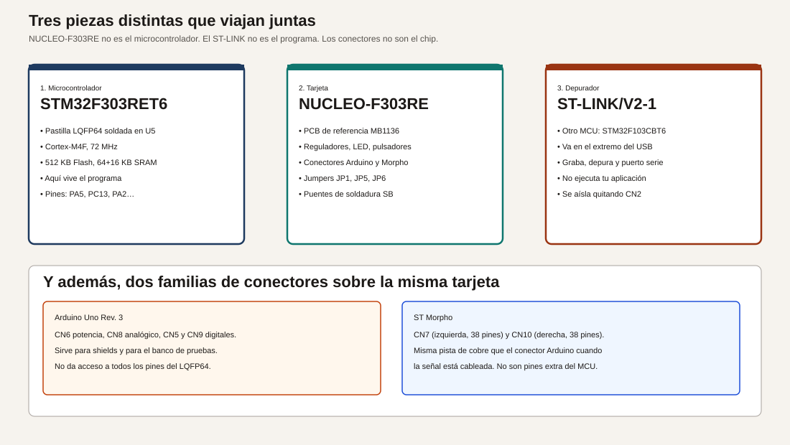
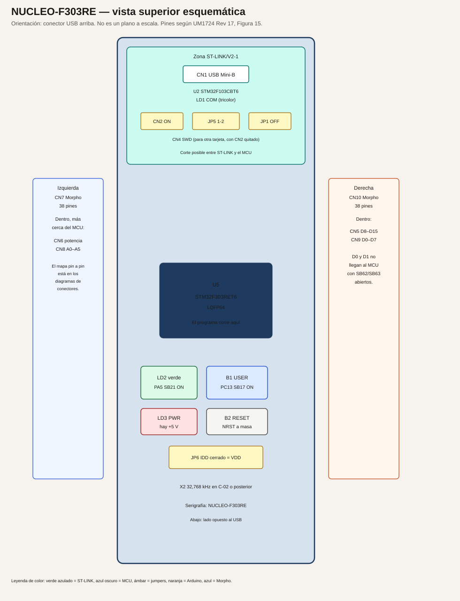
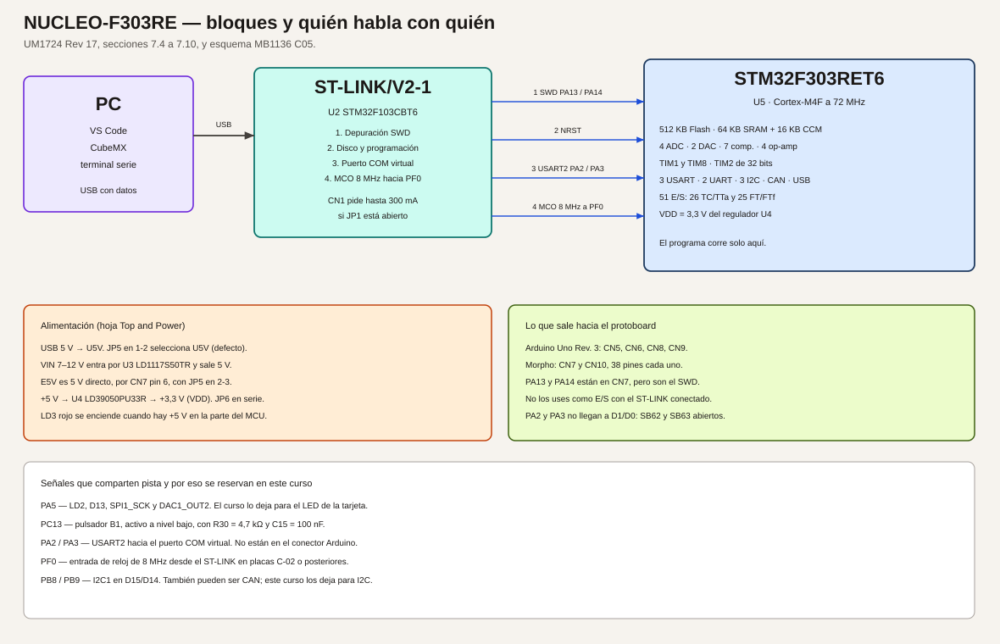
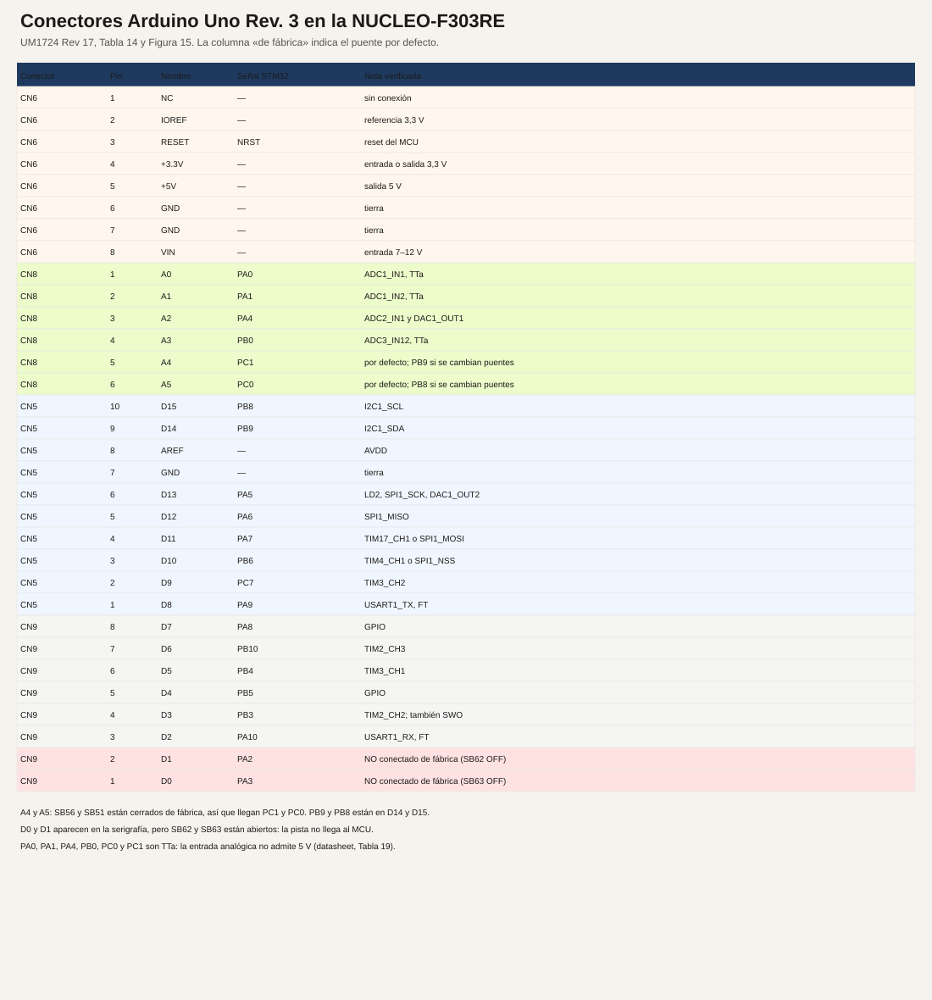
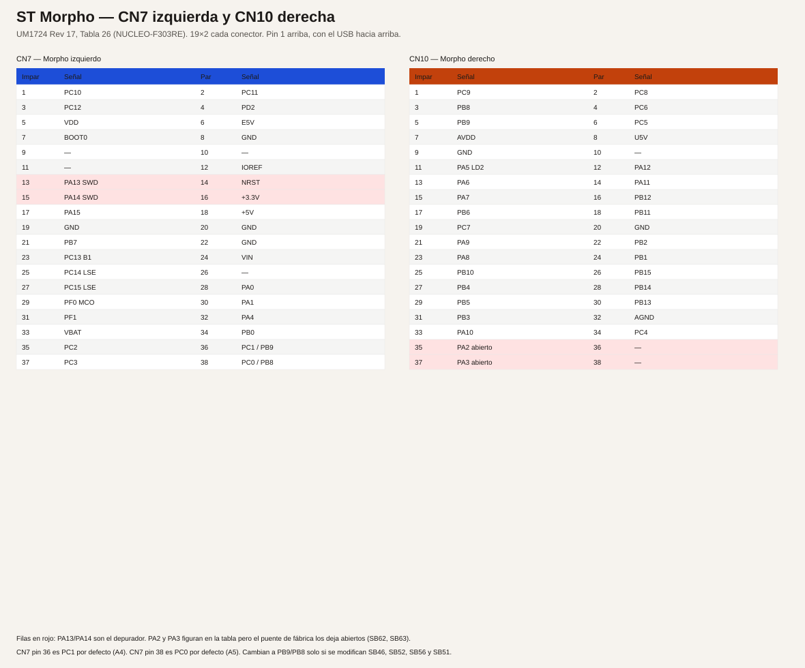
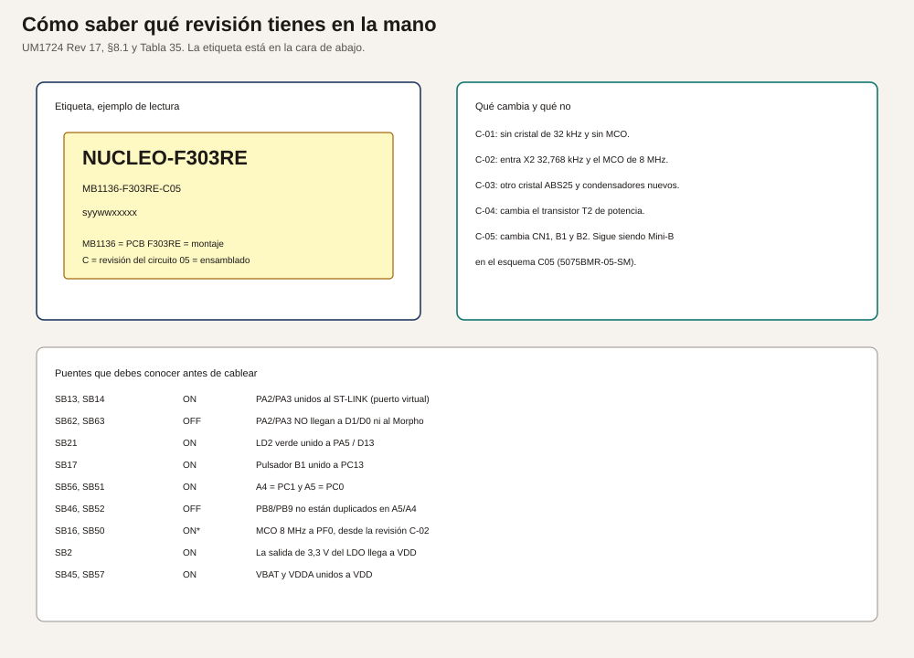
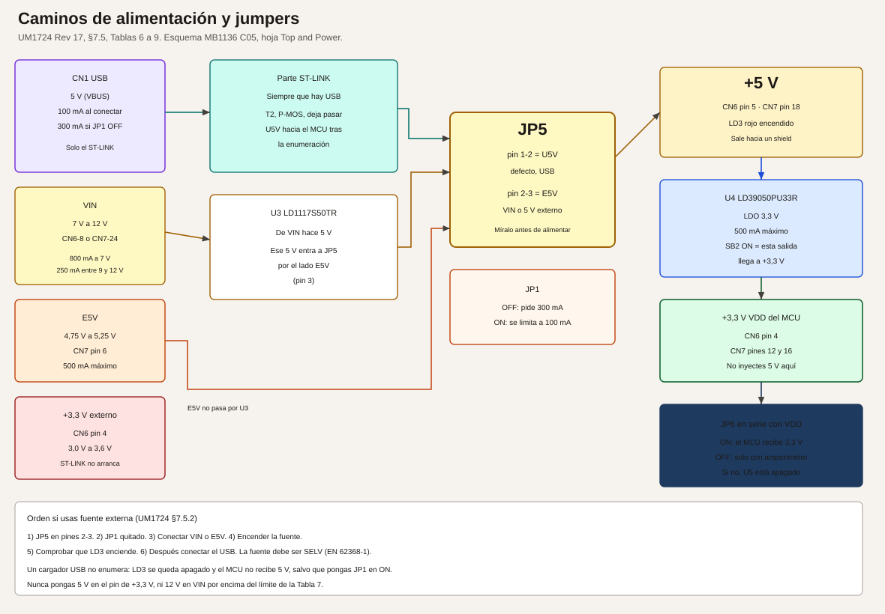

# Módulo 1. Arquitectura de la tarjeta

En este módulo no se escribe código. Se aprende a nombrar cada pieza de la NUCLEO-F303RE y a comprobar, con los ojos y con un polímetro, que la placa que tienes coincide con el manual. El primer programa llega en el módulo 3, cuando ya sepas qué no debes cortocircuitar.

**No comprobado en hardware.** Las observaciones de este módulo describen el comportamiento que UM1724 asigna a los LED y a los reguladores. No son medidas tomadas para redactar el curso.

## Objetivos

Al terminar puedes:

1. Señalar en la placa el microcontrolador, el ST-LINK, los dos conectores Morpho y los cuatro conectores Arduino, y decir qué hace cada uno.
2. Leer la etiqueta inferior y anotar la revisión MB1136.
3. Explicar por qué PA5, PC13, PA2, PA3, PA13 y PA14 no están libres.
4. Alimentar la placa por USB con los jumpers de fábrica y reconocer LD1 y LD3.
5. Medir, sin quitar componentes, la tensión de +5 V y la de +3,3 V en los pines que indica el manual.

## Prerrequisitos

Sabes usar un polímetro en tensión continua y sabes que un pin de alimentación no se une a tierra. No hace falta haber programado en C ni haber usado un microcontrolador.

Lee antes [Fuentes y entorno](00-fuentes-y-entorno.md) hasta la sección del cable. La instalación completa del compilador puede esperar al módulo 3. Para este módulo basta el cable y la placa.

## Material de las tres prácticas

| Pieza | Especificación | Para qué |
| --- | --- | --- |
| NUCLEO-F303RE | MB1136, MCU STM32F303RET6 | Es el objeto de estudio |
| Cable USB con datos | Mini-USB tipo B en el lado de la placa, según el esquema C05 | Alimentar y, más adelante, programar |
| Polímetro | Escala de voltios de continua, 20 V o automática | Práctica 3 |
| Dos cables de punta fina o pinzas | Aislados | Apoyar las puntas en CN6 sin puentear pines vecinos |
| Papel | Para anotar la revisión y las dos tensiones | El informe mínimo del módulo |

No hace falta protoboard, fuente externa ni soldador.

## 1. La analogía: una caja de herramientas, no una sola herramienta

Imagina un taladro que te prestan en un maletín. Dentro van el taladro, el cargador y un juego de brocas. Si dices «el maletín está atascado» no se sabe si el fallo es el motor, el cargador o una broca mal puesta.

La NUCLEO-F303RE es el maletín.

- El taladro es el STM32F303RET6. Ahí se ejecuta el programa.
- El cargador es el ST-LINK/V2-1. Pasa el programa al taladro y, además, deja un canal de texto hacia el ordenador.
- Las brocas son los conectores. Unas siguen el patrón Arduino Uno Rev. 3. Otras, las ST Morpho, dejan ver más señales del mismo chip.
- Los jumpers son interruptores ya montados. Los puentes de soldadura son interruptores diminutos que vienen de fábrica en una posición y que no se cambian con la mano.

Cuando algo no funciona, la frase útil no es «la Nucleo no va». Es «LD3 está apagado», o «el ST-LINK se ve en el PC pero el programa no arranca», o «medí 0 V en el pin de 3,3 V».

## 2. Las tres piezas activas

### 2.1 El microcontrolador

**Analogía.** Es el operario que está dentro del cuadro: recibe órdenes, lee sensores y mueve salidas. El armario no piensa.

**Técnico. Verificado** en el datasheet STM32F303xD/E, DocID026415 Rev 5, tabla 2 y descripción del capítulo 2, para el miembro de 512 KB en LQFP64:

- Núcleo Arm Cortex-M4 con unidad de coma flotante, a 72 MHz como máximo.
- 512 KB de memoria Flash. Ahí queda el programa cuando quitas el cable.
- 64 KB de SRAM en el bus de datos, con paridad por hardware en los primeros 32 KB, más 16 KB de CCM (memoria acoplada al núcleo, en el bus de instrucciones y de datos).
- 4 conversores analógico-digitales de 12 bits, 2 canales de conversión digital-analógica, 7 comparadores y 4 operacionales.
- Comunicaciones: 3 I2C, 3 USART, 2 UART, CAN y USB full-speed. Hasta 4 SPI en la familia.
- 51 líneas de entrada y salida en este encapsulado: 26 de tipo TC o TTa, y 25 de tipo FT o FTf.

En el esquema de la placa esa pastilla es **U5**. El programa que escribas corre solo ahí. El ST-LINK tiene otro programa, grabado por ST, que tú no sustituyes en las prácticas.

La revisión de silicio que UM1724 asocia a esta tarjeta es la **Y**, y le aplica la errata ES0261. La revisión se puede leer en el marcado del chip y, por software, en el registro `DBGMCU_IDCODE`. En este módulo basta con saber que existe.

### 2.2 La tarjeta

**Analogía.** Es el cuadro ya cableado: bornas, piloto de tensión, seta de reset y una fuente de 3,3 V. El operario no trae eso de fábrica dentro de la pastilla.

**Técnico.** La referencia de circuito impreso es **MB1136**. El código de pedido NUCLEO-F303RE significa, según la tabla 2 de UM1724:

| Letras | Significado en NUCLEO-F303RE |
| --- | --- |
| F3 | Serie STM32F3 |
| 03 | Línea STM32F303 |
| R | Encapsulado de 64 pines |
| E | 512 KB de Flash |

La tarjeta añade lo que el chip no trae: el conector USB, los reguladores, los LED, los pulsadores, el cristal de 32,768 kHz, los jumpers y los conectores de expansión.

### 2.3 El ST-LINK/V2-1

**Analogía.** Es el programador de mano que en otros cuadros compras aparte. Aquí viene atornillado en un extremo del mismo circuito, pero sigue siendo otro aparato. Tiene su propio microcontrolador.

**Técnico. Verificado** en UM1724, secciones 1 y 7.4, y en la tabla 10:

- El integrado del depurador es un STM32F103CBT6.
- Por el mismo USB ofrece tres funciones: depuración SWD, disco de almacenamiento para arrastrar un binario, y puerto serie virtual.
- LD1, el LED tricolor junto a esa zona, habla del ST-LINK. No es un LED de tu programa.
- Los dos puentes de CN2, puestos, unen el depurador al STM32 de la propia placa. Quitados, el mismo ST-LINK puede programar otra placa a través del conector CN4. La tabla 5 de UM1724 describe CN4: pin 1 VDD de la aplicación, pin 2 SWCLK, pin 3 GND, pin 4 SWDIO, pin 5 NRST, pin 6 SWO.
- PA13 es SWDIO y PA14 es SWCLK. Están accesibles en CN7 pines 13 y 15, y el manual dice que no se recomienda usarlos como entradas o salidas normales si la parte ST-LINK no se ha separado.

En este curso CN2 se queda siempre puesto, salvo el día en que se explique cómo depurar una placa externa.

## 3. Vista de la placa

El dibujo no es un plano mecánico. Sirve para orientar la placa con el USB hacia arriba y para ponerle nombre a las zonas. El mapa pin a pin está en las dos figuras siguientes, copiadas de la figura 15 y de las tablas 14 y 26 de UM1724 Rev 17.

Con el USB arriba:

- El extremo superior es la zona ST-LINK. Ahí están CN1, LD1, CN2 y el conector pequeño CN4.
- El centro inferior es U5, el STM32F303RET6.
- A la izquierda queda el Morpho CN7. Más hacia dentro están CN6 (alimentación) y CN8 (A0 a A5).
- A la derecha queda el Morpho CN10. Más hacia dentro están CN5 (D8 a D15) y CN9 (D0 a D7).
- LD2, el LED verde de usuario, y B1, el pulsador azul, están en la zona del microcontrolador, no en la del ST-LINK.
- LD3 es el piloto rojo de 5 V. B2 es el reset negro.

## 4. Quién está unido a quién

Hay cuatro caminos entre el ST-LINK y el STM32F303RET6. Conviene saberse el número, porque un fallo de comunicación casi siempre es uno de estos cuatro.

| Camino | Pines del STM32F303RET6 | Cómo viene de fábrica | Si lo cortas |
| --- | --- | --- | --- |
| SWD | PA13, PA14 | CN2 puesto | Dejas de poder depurar esta placa |
| Reset | NRST, a través de SB12 | SB12 cerrado | El depurador ya no puede resetear el chip por CN4 |
| Puerto serie | PA2 (TX), PA3 (RX) | SB13 y SB14 cerrados | El puerto COM virtual deja de hablar |
| Reloj de 8 MHz | PF0, entrada OSC_IN | En C-02 o posterior: SB16 y SB50 cerrados, SB55 abierto | El chip pasa a usar su reloj interno. CubeMX debe saberlo |

**Verificado** en UM1724 §7.9.1, §7.10 y tabla 10.

El reloj de 8 MHz no es un cristal de la zona del STM32F303RET6. Es una salida MCO del STM32F103 del ST-LINK. La frecuencia no se cambia: el manual la fija en 8 MHz. Por eso, en CubeMX, la placa NUCLEO-F303RE se configura con esa entrada externa y no con un cristal HSE propio. El cristal que sí está en la zona del MCU, a partir de la revisión C-02, es el de 32,768 kHz del calendario (LSE), referencia X2 en el esquema, componente recomendado ABS25-32.768KHZ-6-T.

## 5. LED, pulsadores y jumpers que vas a tocar con los dedos

### LD1, LD2 y LD3

**Analogía.** LD1 es el piloto del cargador. LD3 es el piloto de «hay tensión en el cuadro». LD2 es el único piloto que tu programa enciende.

**Técnico. Verificado** en UM1724 §7.6:

- LD1 es tricolor (verde, naranja, rojo) y describe la comunicación del ST-LINK. Rojo lento al dar tensión, rojo rápido tras enumerar, rojo fijo al terminar de hablar con el PC, verde cuando el enlace con el microcontrolador de destino está listo, rojo y verde alternos mientras hay comunicación, verde fijo si terminó bien, naranja si la comunicación falló.
- LD2 es verde. En la NUCLEO-F303RE está unido a PA5, que es D13. Lo dice la tabla 14. El nivel alto enciende el LED y el nivel bajo lo apaga. El puente SB21, cerrado de fábrica, es el que une el LED con esa pista. En el esquema C05 la resistencia en serie es R31, de 510 Ω.
- LD3 es rojo y se enciende cuando la parte del microcontrolador tiene +5 V.

Un límite útil, sin conocer la caída exacta del LED: si PA5 estuviera a 3,3 V y el LED se comportara como un cortocircuito, la corriente por R31 sería 3,3 V / 510 Ω = 6,5 mA. Con la caída real del LED la corriente es menor. En los dos casos queda por debajo de los 25 mA de máximo absoluto de un pin (datasheet, tabla 17). El módulo 2 trata ese máximo como lo que es: un límite que no hay que usar de corriente de trabajo.

### B1 y B2

**Analogía.** B1 es un pulsador de marcha que tu programa puede leer. B2 es la seta de reset: no avisa al programa, corta el trabajo y lo empieza de cero.

**Técnico.**

- B1, azul, está unido a PC13, pin 2 del LQFP64. SB17 cerrado lo conecta. En el esquema C05, hoja del MCU, R30 es 4,7 kΩ a VDD y C15 es 100 nF. El pulsador cierra a masa, así que en reposo el pin está a nivel alto y, pulsado, a nivel bajo. El manual lo asigna al pin PC13 en la sección 7.7. PC13 es de tipo TC. La nota 2 de la tabla de pines del datasheet añade un límite que no tienen el resto de salidas: PC13, PC14 y PC15 pasan por un interruptor que solo absorbe 3 mA, no deben alimentar un LED y, si alguna vez se usan como salida, no deben pasar de 2 MHz con 30 pF. En este curso PC13 se queda como entrada.
- B2, negro, une NRST a masa mientras está pulsado. Hay un condensador de 100 nF (C14) y una resistencia de 10 kΩ (R33) en esa red de reset, según la misma hoja.

Si un shield aprieta la caperuza de B2, el chip se queda en reset para siempre. UM1724 lo advierte: las caperuzas se pueden quitar.

### JP5, JP1, JP6 y CN2

| Jumper | Posición de fábrica | Qué decide |
| --- | --- | --- |
| CN2, dos puentes | Puestos | El ST-LINK programa el STM32 de esta placa |
| JP5 | Pines 1 y 2, lado U5V | La parte del MCU se alimenta del USB |
| JP1 | Abierto | La placa pide 300 mA al PC durante la enumeración |
| JP6, marcado IDD | Puesto | VDD llega al microcontrolador |

**Verificado** en UM1724, tablas 6 y 8, y sección 7.8. JP6 abierto y sin amperímetro deja el microcontrolador sin alimentación aunque LD3 pueda seguir diciendo que hay 5 V aguas arriba. No lo quites en este módulo.

## 6. Los dos conectores no son dos microcontroladores

**Analogía.** El conector Arduino es un ladrón de tres tomas ya etiquetadas. El Morpho es la regleta completa del mismo cuadro. Si una toma del ladrón y un borne de la regleta llevan el mismo nombre, es el mismo hilo, no un hilo nuevo.

**Técnico.** UM1724, figura 15, dibuja las dos familias a la vez. Por ejemplo PA5 está en D13 (CN5 pin 6) y también en CN10 pin 11. Es la misma pista de cobre. Lo que escribas en el registro de PA5 se ve en los dos conectores y en LD2.

Hay tres excepciones que el dibujo de la serigrafía no grita:

1. **D0 y D1.** La figura 15 y la tabla 14 les ponen PA3 y PA2. La tabla 10 dice que, con SB62 y SB63 abiertos, esas pistas no llegan ni a CN9 ni al Morpho. De fábrica el puerto serie se queda dentro de la placa, camino del ST-LINK. Medir D0 respecto a GND no es medir PA3.
2. **A4 y A5.** De fábrica, SB56 y SB51 cerrados, son PC1 y PC0. PB8 y PB9, que son el I2C1, están en D15 y D14, no en A4 y A5. Para duplicar el I2C en A4 y A5 habría que abrir SB56 y SB51 y cerrar SB46 y SB52. Este curso no lo pide.
3. **PA13 y PA14** aparecen en CN7, pero son el depurador.

La tabla completa que usarán los módulos está en el [índice](01-indice-y-matriz.md). Si un tutorial de Internet usa D0 como recepción serie en una Nucleo-64, ese tutorial supone los puentes cambiados. En la placa de este curso, tal como sale de la caja, eso es falso.

## 7. Revisión de la placa

**Analogía.** Es el número de plano pintado en el interior de la puerta del cuadro. Dos cuadros con el mismo nombre comercial pueden llevar un relé distinto si el plano cambió.

**Técnico. Verificado** en UM1724 §8.1 y tablas 34 y 35. La etiqueta inferior lleva una línea del estilo `MB1136-F303RE-C05`.

| Trozo | Significado |
| --- | --- |
| MB1136 | El circuito impreso de las Nucleo-64 de este manual |
| F303RE | Qué microcontrolador hay montado |
| C | Revisión del circuito |
| 05 | Revisión de ensamblado |

Para la NUCLEO-F303RE el manual lista estas revisiones:

| Revisión | Cambio que describe UM1724 | Consecuencia para las prácticas |
| --- | --- | --- |
| C-02 | Aparecen el cristal de 32,768 kHz y el reloj MCO de 8 MHz desde el ST-LINK | Es el punto de partida de las unidades F303RE que lista la tabla 34 |
| C-03 | El cristal pasa a ser el ABS25 y cambian C31, C32 y C26 | Sigue habiendo LSE. No cambia el mapa de conectores |
| C-04 | Cambia la referencia del transistor de potencia T2 | No cambia los pines de usuario |
| C-05 | Cambian CN1, B1 y B2, y la serigrafía | El esquema C05 especifica CN1 como Mini-USB B, pieza 5075BMR-05-SM. Mira el conector real si tu letra final no es 05 |

La tabla 34 no lista una NUCLEO-F303RE de revisión C-01. La sección de relojes sí explica la C-01 para la familia MB1136 en general: en esa revisión no hay cristal de 32 kHz y el HSE no se usa. Si algún día vieras C-01 en una F303RE, no des por hecho el MCO de 8 MHz y anótalo antes de configurar CubeMX.

Anota en tu cuaderno la cadena completa de la etiqueta. Los módulos de reloj y de bajo consumo te la van a pedir.

## 8. Alimentación, solo lo que hace falta para no equivocar el polímetro

El detalle de límites, de VIN y de la secuencia con fuente externa es el módulo 2. Aquí basta el camino de fábrica.

**Analogía.** El USB entrega 5 V, como un alimentador de teléfono. El microcontrolador trabaja a 3,3 V, como una linterna de dos pilas que no admite el cargador del teléfono en sus bornes de bombilla. Entre medias hay un regulador. Si metes los 5 V en el borne de 3,3 V, te saltas el regulador.

**Técnico. Verificado** en UM1724 §7.5 y en el esquema C05, hoja de alimentación:

- Con JP5 en 1-2, U5V (los 5 V del USB, después del interruptor que controla el ST-LINK) alimenta la red de +5 V.
- U4 es un LD39050PU33R. De los 5 V obtiene 3,3 V. El manual limita a 500 mA la corriente que puedes sacar por el pin de 3,3 V.
- U3, un LD1117S50TR, solo entra en juego si alimentas por VIN (7 V a 12 V). Con el USB no hace falta.
- El +3,3 V sale, o puede entrar, por CN6 pin 4 y por CN7 pines 12 y 16.
- El +5 V sale por CN6 pin 5 y por CN7 pin 18.
- IOREF, CN6 pin 2, es la referencia de 3,3 V para un shield. No es una fuente de potencia pensada para un motor.

La tierra de la placa es la referencia de todas las medidas de este módulo. GND está en CN6 pines 6 y 7, en CN5 pin 7, y en varios pines de los Morpho. Usa siempre el mismo GND de la placa. No uses la tierra de un enchufe de pared ni la masa de un osciloscopio de laboratorio hasta que el módulo 2 haya hablado de qué tierras se pueden unir.

## Práctica 1. Ponerle nombre a la placa

**Problema.** Sin un nombre para cada zona, el resto del curso se vuelve una lista de siglas.

**Objetivo.** Relacionar el dibujo con la placa física.

**Conocimientos previos.** Ninguno de programación.

**Material.** La placa, sin cable todavía.

**Pasos.**

1. Pon la placa en la mesa con el conector USB hacia ti, en el borde más cercano, y luego gírala hasta que el USB quede en el borde lejano, como en el dibujo. El curso siempre la describe con el USB arriba.
2. Toca, sin pulsar todavía, estas piezas y di en voz alta el nombre de la columna derecha.

| Lo que tocas | Nombre | Qué no es |
| --- | --- | --- |
| El conector USB del extremo | CN1, entrada del ST-LINK | Una boca USB del STM32F303RET6. El chip no tiene un conector USB propio en esta placa |
| El integrado junto a ese USB | U2, STM32F103CBT6 | U5 |
| El LED tricolor de esa zona | LD1 | LD2 |
| Los dos puentes negros pequeños de esa zona | CN2 | JP5 |
| El cuadrado negro grande del centro, 64 patillas | U5, STM32F303RET6 | El ST-LINK |
| El LED verde cerca de los conectores de la derecha | LD2, unido a PA5 | Un LED de alimentación |
| El pulsador azul | B1, unido a PC13 | El reset |
| El pulsador negro | B2, NRST | Un pulsador de usuario |
| El LED rojo | LD3 | LD2 |
| La hilera larga de la izquierda | CN7, Morpho | El conector Arduino |
| La hilera interior izquierda, más corta, de alimentación | CN6 | CN7 |
| La hilera interior izquierda de seis pines analógicos | CN8 | CN6 |
| Las dos hileras interiores de la derecha | CN5 arriba (D8–D15) y CN9 abajo (D0–D7) | El Morpho CN10, que es la hilera exterior |

3. Localiza el pin 1 de CN7 y el pin 1 de CN10. En la figura 15 de UM1724 el pin 1 es el extremo más cercano al USB. La serigrafía de la placa marca el pin 1. Si la marca de tu ejemplar no coincide con lo que esperabas, anótalo y no cuentes pines desde el extremo contrario.

**Resultado esperado.** Puedes señalar U5 y U2 sin dudar, y sabes que D13 y el LED verde son la misma señal PA5.

**Criterio.** Otra persona, con tu lista, encuentra B1 y CN6 pin 4 en menos de un minuto.

## Práctica 2. Leer la revisión

**Problema.** Un esquema C05 no describe un cristal que una C-01 no tiene. Hay que saber cuál estás mirando.

**Objetivo.** Copiar la identificación de la etiqueta.

**Material.** La placa. Una linterna del teléfono ayuda.

**Pasos.**

1. Da la vuelta a la placa, con el USB todavía como referencia de «arriba», para no perder la orientación al volver.
2. Busca la etiqueta que contiene `MB1136` y `F303RE`.
3. Copia, letra a letra, la línea de revisión y la línea de serie.
4. Vuelve a la cara de componentes y comprueba que sigues distinguiendo B1 de B2.

**Resultado esperado.** Una línea del estilo `MB1136-F303RE-C0x`. El manual, para unidades ya distribuidas, muestra C02, C03, C04 y C05.

**Si la etiqueta no dice F303RE.** No continúes con este curso como si lo fuera. Otra Nucleo-64 puede llevar PA5 en otro sitio. LD2, por ejemplo, es PB13 en algunas referencias del mismo manual.

**Criterio.** En el cuaderno quedan la revisión y la fecha en que la leíste.

## Práctica 3. Alimentar por USB y medir

**Problema.** Antes de conectar un sensor hay que ver que la fuente de la propia placa está viva, y hay que saber en qué agujero está cada tensión.

**Objetivo.** Encender la placa con los jumpers de fábrica y anotar dos tensiones.

**Conocimientos previos.** Prácticas 1 y 2. Polímetro en voltios de continua.

**Material.** Cable de datos, polímetro, placa.

**Configuración que no se modifica.**

| Elemento | Posición | Sección del manual |
| --- | --- | --- |
| CN2 | Los dos puentes puestos | §7.4 |
| JP5 | Entre 1 y 2 (U5V) | Tabla 8 |
| JP1 | Sin puente | Tabla 6 |
| JP6 | Puesto | §7.8 |

**Pasos.**

1. Con la placa desconectada, confirma los cuatro puntos de la tabla. Si JP5 está entre 2 y 3, no la alimentes por USB hasta devolverlo a 1-2: esa posición espera VIN o E5V.
2. Enchufa el cable al CN1 y al PC. No uses un cargador de teléfono suelto: UM1724 avisa de que, sin enumeración, LD3 se queda apagado y el microcontrolador no recibe 5 V.
3. Observa LD1 y LD3 durante diez segundos. Anota los colores, no los interpretes todavía.
4. Pon el polímetro en voltios de continua. Punta negra a GND de CN6 pin 6. Punta roja a CN6 pin 5 (+5 V). Anota.
5. Sin mover la punta negra, pasa la roja a CN6 pin 4 (+3,3 V). Anota.
6. Aparta las puntas antes de guardar el polímetro. No midas corriente en esta práctica: la escala de amperios del polímetro es casi un cortocircuito.

**Tabla de la medida.**

| Medida | Conector | Pin | Señal | Qué dice el diseño |
| --- | --- | --- | --- | --- |
| Tierra | CN6 | 6 | GND | Referencia, 0 V |
| Cinco voltios | CN6 | 5 | +5 V | Salida de la red de 5 V cuando LD3 está encendido |
| Tres voltios tres | CN6 | 4 | +3,3 V | Salida de U4, regulador de 3,3 V |

**Resultado esperado, no medido en la redacción de este curso.**

- LD3 encendido, de forma continua, si el PC concedió la corriente y JP5 está en U5V.
- LD1 siguiendo la secuencia de UM1724 §7.6. Con el programa de demostración que muchas placas traen de fábrica, LD2 puede parpadear. Eso es el programa que ST dejó en la Flash, no un fallo. B1, en esa demostración, cambia el ritmo. Lo dice la guía rápida del propio manual, al principio del capítulo de hardware.
- En CN6 pin 5, una tensión cercana a 5 V. El USB puede estar un poco por debajo o por encima. Anota el número; no lo redondees a 5,00 si leíste 4,85.
- En CN6 pin 4, una tensión cercana a 3,3 V, que es la consigna del LD39050PU33R.

**Este texto no incluye una medida de ejemplo tomada en laboratorio.** Cuando hagas la tuya, etiquétala como medida tuya.

**Diagnóstico.**

| Observación | Lectura más probable | Qué no hacer |
| --- | --- | --- |
| LD3 apagado y 0 V en los dos pines | JP5 mal puesto, JP6 abierto, cable solo de carga, o el PC negó los 300 mA | No pongas 5 V con una fuente en el pin de 3,3 V para «arreglarlo» |
| LD3 apagado y alimentas con un cargador | No hubo enumeración USB | El manual permite cerrar JP1 para este caso concreto. Vuelve a dejarlo abierto cuando regreses al PC |
| 5 V correctos y 0 V en el pin de 3,3 V | JP6 abierto, o SB2 abierto | No puentes JP6 con un cable largo y finísimo que luego se suelte sobre GND |
| LD2 no parpadea | La Flash ya no tiene la demostración, porque alguien la borró | No es un fallo de alimentación si LD3 está encendido y hay 3,3 V |
| La punta resbala y une +5 V con +3,3 V | Cortocircuito entre raíles | Suelta el cable del PC enseguida. No repitas la medida hasta entender qué pines tocaste |

**Variación.** Repite la medida de 3,3 V usando CN7 pin 16 como punto rojo y CN7 pin 20 como GND. Tiene que ser la misma red. Si difiere en más de la resolución de tu polímetro, una de las dos puntas no estaba en el pin que creías.

**Criterio de que la práctica está hecha.** En el cuaderno hay: revisión de la placa, color de LD3, tensión anotada en CN6 pin 5 y tensión anotada en CN6 pin 4, con la escala del polímetro.

## Resumen

- La NUCLEO-F303RE es una placa MB1136. El programa vive en el STM32F303RET6 (U5). El ST-LINK es otro microcontrolador, un STM32F103CBT6 (U2).
- Arduino y Morpho son dos enchufes de las mismas señales, más las que el Arduino no saca.
- De fábrica, el LED verde es PA5, el pulsador azul es PC13, y el puerto serie del PC es PA2/PA3 por dentro de la placa, no por D0/D1.
- PA13 y PA14 son el depurador.
- Con JP5 en 1-2, JP6 puesto y un cable de datos, LD3 indica que hay 5 V, y U4 fabrica los 3,3 V del chip.
- La revisión se lee en la etiqueta de abajo. Las unidades F303RE que lista el manual empiezan en C-02.

## Glosario

| Término | Definición en este curso |
| --- | --- |
| MCU | Microcontroller unit. Aquí, el STM32F303RET6 |
| Placa o tarjeta | El circuito impreso completo, NUCLEO-F303RE |
| ST-LINK/V2-1 | Depurador y programador integrado, con puerto serie virtual |
| SWD | Serial Wire Debug. Dos hilos, SWDIO y SWCLK, por los que el depurador controla el chip |
| GPIO | Patilla que el programa puede usar como entrada o como salida digital |
| Pin físico | Número de la patilla en el encapsulado LQFP64, o número del contacto en CN5, CN6, CN7, CN8, CN9 o CN10. No son la misma cuenta |
| Jumper | Puente que se quita con la mano: CN2, JP1, JP5, JP6 |
| Solder bridge | Puente de soldadura, SBxx. Viene cerrado o abierto de fábrica |
| VDD | Alimentación positiva del microcontrolador. En esta placa, 3,3 V |
| GND | Referencia de 0 V de la placa |
| TTa | Tipo de pin analógico cuya entrada no debe pasar de VDDA + 0,3 V |
| FT, FTf | Tipo de pin que el datasheet admite, como máximo absoluto de entrada, hasta 5,5 V |
| MCO | Salida de reloj de un microcontrolador. Aquí, la de 8 MHz del ST-LINK hacia PF0 |
| LSE | Oscilador de baja velocidad, 32,768 kHz, para el calendario |
| SELV | Tensión de seguridad muy baja, en el sentido de la norma que cita UM1724 para una fuente externa |

## Preguntas

Las respuestas están debajo, a propósito, para que intentes responder antes de desplazar la página.

**1.** ¿El LED verde LD2 demuestra que el ST-LINK está hablando con el PC?

Respuesta. No. LD2 está unido a PA5 del STM32F303RET6. Quien habla del enlace con el PC es LD1. LD3 habla de la presencia de 5 V. Un parpadeo de LD2, con la demostración de fábrica, solo dice que el programa de U5 está corriendo.

**2.** ¿Por qué un shield que usa D0 y D1 como puerto serie no recibe datos en esta placa, recién sacada de la caja?

Respuesta. Porque SB62 y SB63 están abiertos. PA2 y PA3 van al ST-LINK por SB13 y SB14, no al conector CN9. Habría que invertir esos puentes, y entonces el puerto virtual del USB dejaría de estar unido a USART2.

**3.** ¿PA5 y D13 son dos salidas?

Respuesta. No. Son dos sitios de la misma pista, y además el LED LD2 cuelga de ella mientras SB21 esté cerrado.

**4.** ¿Se puede alimentar un motor pequeño desde CN6 pin 4 porque el regulador admite 500 mA?

Respuesta. El manual fija 500 mA como capacidad máxima de U4, no como permiso para un motor. Un motor pide picos, mete ruido en la misma red de la que vive el microcontrolador y su bobina necesita un diodo. Los motores van con etapa externa y fuente propia. El módulo 10 lo monta así. Además, la suma de corriente de los pines del chip es otro límite, distinto del límite del regulador.

**5.** ¿Qué revisión hace que PF0 reciba 8 MHz del ST-LINK?

Respuesta. UM1724 §7.9.1 asigna esa configuración a MB1136 C-02 o posterior. La NUCLEO-F303RE de la tabla 34 nace en C-02, así que es lo esperado. La etiqueta manda si no coincide.

**6.** ¿El conector USB de la placa es el USB del STM32F303RET6?

Respuesta. No. CN1 pertenece al ST-LINK. El USB full-speed del STM32F303RET6 está en los pines PA11 y PA12, que salen al Morpho y que este curso reserva para CAN. No hay un segundo conector USB cableado a U5.

## Ejercicios adicionales

1. Dibuja a mano, en medio folio, la placa con el USB arriba y marca solo ocho cosas: CN1, U2, U5, LD2, B1, B2, CN7 y CN10. Compáralo con la figura de la vista superior.
2. Sin mirar la tabla, di qué señal hay en A0, A2 y D13. Después compruébalo. A0 es PA0, A2 es PA4, D13 es PA5.
3. Explica, con tus palabras, la diferencia entre quitar CN2 y abrir SB21.
4. Busca en el datasheet, tabla 13, el tipo del pin PC13 y el del pin PA0. Uno es entrada de pulsador y el otro será entrada analógica. Anota si alguno de los dos es tolerante a 5 V. La respuesta está en el módulo 2; inténtalo antes.

## Lista de comprobación

Sigue al módulo 2 solo si puedes marcar todo esto.

- [ ] Distingo U5 de U2 sin mirar el dibujo.
- [ ] Sé que LD1, LD2 y LD3 informan de cosas distintas.
- [ ] He copiado la revisión `MB1136-F303RE-Cxx` de mi placa.
- [ ] CN2, JP5, JP1 y JP6 están como en la tabla de la práctica 3.
- [ ] He anotado la tensión de CN6 pin 5 y la de CN6 pin 4.
- [ ] Sé que D0 y D1 no llevan PA3 y PA2 mientras no se suelden SB62 y SB63.
- [ ] Sé que PA13 y PA14 no se usan como salidas.
- [ ] No he inyectado 5 V en el pin de 3,3 V.

## Módulo siguiente

El módulo 2, **Alimentación, niveles de tensión y límites eléctricos**, parte de la medida que acabas de hacer. Ahí se calculan la corriente de un LED externo, la diferencia entre un pin TTa y un pin FT, el tope de 25 mA y de 80 mA, y la secuencia correcta si algún día alimentas la placa por VIN. Todavía no se instala el compilador: eso es el módulo 3, para no mezclar un fallo de jumpers con un fallo de software.
