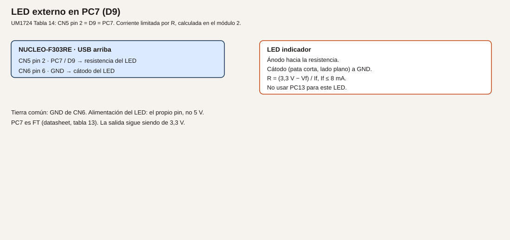
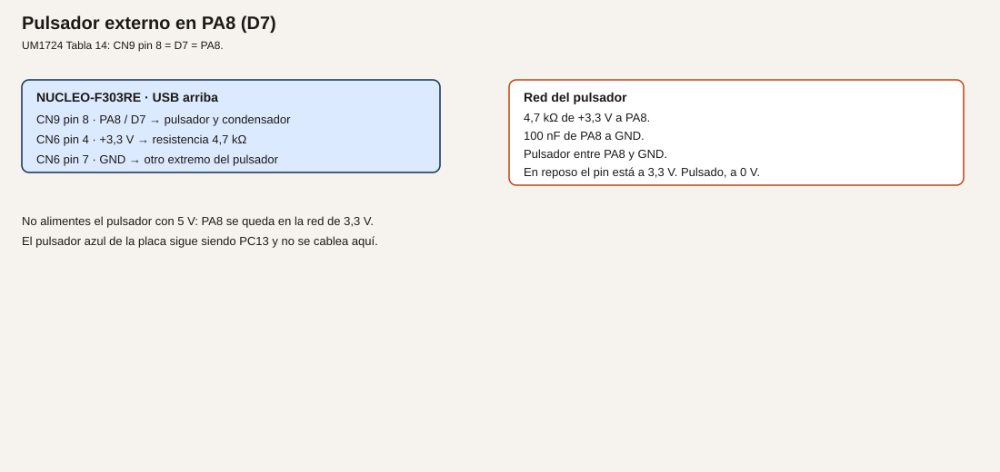

# Módulo 5. GPIO: salidas, entradas y antirrebote

Un GPIO es un borne del chip que el programa pone a 3,3 V, a 0 V, o que lee. En un cuadro sería un piloto o un pulsador de marcha. Aquí la tensión es 3,3 V y la corriente de cada LED sale del cálculo del [módulo 2](03-modulo-02-alimentacion.md).

**No comprobado en hardware.** El cableado sigue UM1724 Rev 17 y el datasheet DocID026415 Rev 5. El código no se compiló al redactarlo.

## Objetivos

- Configurar una salida push-pull y una entrada.
- Encender un LED externo sin usar PA5 ni PC13.
- Leer B1 y un pulsador externo, este último con antirrebote por tiempo.
- Mantener cada LED en la zona de unos 8 mA, no en el máximo absoluto de 25 mA.

## Prerrequisitos

Módulos 2, 3 y 4. Protoboard, cables, un LED indicador con su hoja, resistencias, un pulsador, 4,7 kΩ y 100 nF.

## Salida y entrada

**Analogía.** Una salida es un contactor que tú cierras. Una entrada es un final de carrera que tú miras. El pull-up es un muelle que deja el borne en reposo a tensión alta cuando nadie lo empuja a masa. Sin ese muelle, el borne al aire no es un «uno» ni un «cero»: es ruido.

**Técnico. Verificado en el datasheet, tabla 66.** La resistencia de pull-up o pull-down interna está entre 25 kΩ y 55 kΩ, típico 40 kΩ. Para un pulsador de mando este curso añade 4,7 kΩ externos, del mismo orden que R30 del esquema C05 en B1, porque el valor interno varía.

PC13 es el pulsador azul B1, activo a nivel bajo, con SB17 cerrado (UM1724 §7.7 y tabla 10). La nota 2 de la tabla de pines del datasheet prohíbe usar PC13 como fuente de corriente: no alimenta un LED. En el encapsulado de 64 pines, PC13 es tipo TC.

PC7 es D9, CN5 pin 2, tipo FT (datasheet, tabla 13, pin 38 del LQFP64). La salida sigue siendo de 3,3 V. Lo usamos como salida del LED externo para no compartir PA5 con LD2.

PA8 es D7, CN9 pin 8, tipo FTf. En este módulo es solo entrada del pulsador externo.

## Ejemplo 1. LD2 y un LED externo en PC7

1. **Problema.** Encender un piloto que no es el de la placa, con la corriente calculada.
2. **Objetivo.** PA5 y PC7 se encienden y se apagan juntos.
3. **Material.** LED indicador, resistencia calculada, protoboard, cables. El ejemplo numérico de abajo usa Vf = 2,0 V e If = 5 mA. Si tu hoja dice otra cosa, recalcula y usa tu valor.
4. **Funcionamiento.** Nivel alto en el pin, corriente por la resistencia y el LED, retorno por GND. Push-pull: el pin empuja a alto y a bajo. No hace falta pull.
5. **Dibujo.**



6. **Cableado.**

| Origen | Destino | Notas |
| --- | --- | --- |
| CN5 pin 2, PC7 / D9 | Resistencia, y de ahí al ánodo | Pata larga del LED típico |
| Cátodo | CN6 pin 6 o pin 7, GND | Pata corta, lado plano |
| CN1 | PC | USB, como hasta ahora |

7. **Cálculos.** R = (3,3 − 2,0) / 0,005 = 260 Ω. El valor E12 siguiente es 270 Ω. If = 1,3 / 270 = 4,8 mA. Cabe en 8 mA por pin y, con LD2, la suma queda muy por debajo de 80 mA (datasheet, tabla 17, máximos absolutos). **Convención de este curso** si no tienes aún la hoja: 270 Ω. Con tu Vf, repite la cuenta.
8. **CubeMX.** PC7 como `GPIO_Output`, push-pull, sin pull, velocidad baja, etiqueta `LED_EXT`. PA5 sigue como LD2. Genera el código.
9. **Código.**

```c
/* USER CODE BEGIN WHILE */
while (1)
{
  HAL_GPIO_TogglePin(GPIOA, GPIO_PIN_5);
  HAL_GPIO_TogglePin(GPIOC, GPIO_PIN_7);
  HAL_Delay(300);
  /* USER CODE END WHILE */
```

10. **Dónde.** Bucle de `Core/Src/main.c`.
11. **Compilar y probar.** Build, ST-LINK, reanudar. No dejes el programa parado si quieres ver el parpadeo.
12. **Esperado, no medido.** LD2 y el LED externo cambian a la vez. La corriente real se mide, si quieres, como caída en la resistencia dividida por 270 Ω. Esa medida es tuya.
13. **Fallos.** Solo LD2 parpadea: PC7 no está como salida, o el cátodo no va a GND. El LED externo siempre encendido: ánodo y cátodo al revés no enciende; si enciende fijo, el pin se quedó a 1 porque el programa no corre. PC13 con un LED: no lo hagas.
14. **Variación.** Apaga PC7 con `HAL_GPIO_WritePin(GPIOC, GPIO_PIN_7, GPIO_PIN_RESET)` y deja solo PA5. Así compruebas que son dos salidas.
15. **Criterio.** Los dos LED cambian, y puedes señalar la resistencia y el valor de If que usaste.

## Ejemplo 2. B1 enciende LD2 mientras se mantiene

1. **Problema.** Leer un mando de la propia placa sin soldar nada.
2. **Objetivo.** LD2 encendido solo mientras B1 está pulsado.
3. **Material.** La placa. B1 es el pulsador azul, no el negro de reset.
4. **Funcionamiento.** PC13 tiene pull-up en la placa (R30 = 4,7 kΩ en el esquema C05) y el pulsador lo lleva a GND. Pulsado = nivel bajo. El programa lee y copia el estado invertido a PA5.
5. **Dibujo.** No hay cableado externo. B1 está en la tarjeta, junto al microcontrolador.
6. **Cableado.** Ninguno nuevo. Puedes dejar el LED de PC7 montado; este ejemplo no lo usa.

| Señal | Conector | Uso |
| --- | --- | --- |
| PC13 | CN7 pin 23, con SB17 cerrado | Entrada, activa a bajo |
| PA5 | LD2 | Salida |

7. **Cálculos.** No hay corriente de salida por PC13. Solo se lee.
8. **CubeMX.** PC13 como `GPIO_Input`, sin pull interno si ya confías en R30, o con pull-up. No lo pongas como salida. En la inicialización de la placa suele estar ya como B1. Compruébalo.
9. **Código.**

```c
/* USER CODE BEGIN WHILE */
while (1)
{
  if (HAL_GPIO_ReadPin(GPIOC, GPIO_PIN_13) == GPIO_PIN_RESET)
  {
    HAL_GPIO_WritePin(GPIOA, GPIO_PIN_5, GPIO_PIN_SET);
  }
  else
  {
    HAL_GPIO_WritePin(GPIOA, GPIO_PIN_5, GPIO_PIN_RESET);
  }
  /* USER CODE END WHILE */
```

10. **Dónde.** Sustituye el bucle del ejemplo 1. El LED de PC7 puede quedarse apagado.
11. **Compilar y probar.** Build, reanudar, pulsar B1 y soltarlo.
12. **Esperado, no medido.** LD2 sigue al pulsador azul, encendido con el dedo encima. Al soltar, se apaga. Puede haber un rebote breve al pulsar: en este ejemplo se acepta porque solo copia el nivel. El ejemplo 3 lo filtra.
13. **Fallos.** LD2 no reacciona: estás leyendo otro pin, o SB17 está abierto, o confundes B1 con B2 (B2 es NRST y reinicia). LD2 siempre encendido: la condición está al revés (`GPIO_PIN_SET` interpretado como pulsado).
14. **Variación.** Copia el mismo nivel a PC7. Sigue sin usar PC13 como salida.
15. **Criterio.** Pulsado enciende, suelto apaga, y PC13 no alimenta nada.

## Ejemplo 3. Pulsador externo en PA8, con antirrebote

1. **Problema.** Un contacto mecánico no hace un solo flanco. Durante unos milisegundos rebota, y un contador ingenuo contaría varias veces.
2. **Objetivo.** Contar una pulsación de un pulsador externo solo cuando el nivel bajo se mantiene 20 ms.
3. **Material.** Pulsador de protoboard, 4,7 kΩ, 100 nF, cables.
4. **Funcionamiento.** En reposo, 4,7 kΩ deja PA8 a 3,3 V. Al pulsar, PA8 va a GND. El condensador de 100 nF frena el flanco. El programa solo acepta el estado nuevo si lleva al menos 20 ms estable. Esos 20 ms son **convención de este curso** para un pulsador de protoboard, no una norma. El tiempo lo lleva `HAL_GetTick`, que avanza con el SysTick del HAL.
5. **Dibujo.**



6. **Cableado.**

| Origen | Destino |
| --- | --- |
| CN6 pin 4, +3,3 V | Un extremo de 4,7 kΩ |
| El otro extremo de 4,7 kΩ | CN9 pin 8, PA8 / D7, y un lado del pulsador |
| El otro lado del pulsador | CN6 pin 6 o 7, GND |
| 100 nF | Entre PA8 y GND |

No uses CN6 pin 5 (+5 V). PA8 no se alimenta a 5 V en esta práctica. PA8 es FTf y la tabla 19 admite hasta 5,5 V en un pin FT, pero el pulsador de este módulo es de 3,3 V a propósito.

7. **Cálculos.** 4,7 kΩ a 3,3 V, con el pulsador cerrado, pide 3,3 / 4700 ≈ 0,7 mA a la fuente, no al pin: el pin solo lee. El pull interno, si lo dejas activo, queda en paralelo y la corriente sube un poco. Puedes desactivar el pull interno en CubeMX porque el externo ya está.
8. **CubeMX.** PA8 como `GPIO_Input`, sin pull, etiqueta `BTN_EXT`. PC13 puede seguir como entrada.
9. **Código.**

```c
/* USER CODE BEGIN PV */
static uint32_t pulsaciones;
/* USER CODE END PV */
```

```c
/* USER CODE BEGIN 0 */
static uint8_t pulsado_estable(void)
{
  static uint8_t aceptado = 1U;
  static uint32_t desde = 0U;
  uint8_t ahora = (HAL_GPIO_ReadPin(GPIOA, GPIO_PIN_8) == GPIO_PIN_RESET) ? 0U : 1U;

  if (ahora == aceptado)
  {
    desde = 0U;
    return aceptado;
  }
  if (desde == 0U)
  {
    desde = HAL_GetTick();
    return aceptado;
  }
  if ((HAL_GetTick() - desde) >= 20U)
  {
    aceptado = ahora;
    desde = 0U;
  }
  return aceptado;
}
/* USER CODE END 0 */
```

```c
/* USER CODE BEGIN WHILE */
while (1)
{
  static uint8_t anterior = 1U;
  uint8_t estable = pulsado_estable();
  if ((anterior == 1U) && (estable == 0U))
  {
    pulsaciones++;
    HAL_GPIO_TogglePin(GPIOA, GPIO_PIN_5);
  }
  anterior = estable;
  /* USER CODE END WHILE */
```

10. **Dónde.** La función en `USER CODE BEGIN 0`. El contador en `PV`. El bucle en `main.c`.
11. **Compilar y probar.** Punto de ruptura en `pulsaciones++`, con la condición de que pare solo ahí. Pulsa una vez, con el dedo quieto un instante.
12. **Esperado, no medido.** Cada pulsación aceptada suma 1 y conmuta LD2. Un roce muy breve, menor de 20 ms, no cuenta. No hay una medida de rebote en este texto: el filtro es de diseño.
13. **Fallos.** Cuenta solo: el pulsador va a 5 V, o falta el GND, o PA8 no es el pin del cable. Cuenta de tres en tres: los 20 ms no se están aplicando y estás contando en otro sitio, o el condensador no está. No enciende: la detección mira el flanco de suelto en vez del de pulsado. Aquí el flanco válido es de 1 a 0.
14. **Variación.** Sube el filtro a 50 ms. Hace falta pulsar más tiempo. Es el mismo algoritmo.
15. **Criterio.** Una pulsación deliberada, una cuenta. PC13 sigue sin usarse como salida.

## Resumen

PC7 enciende un LED con resistencia calculada. PC13 solo se lee. PA8, con 4,7 kΩ y 100 nF, cuenta pulsaciones estables de 20 ms.

## Glosario

| Término | Definición |
| --- | --- |
| Push-pull | La salida empuja a alto y a bajo |
| Pull-up | Resistencia a 3,3 V que define el reposo |
| Activo a bajo | Pulsado cuando el pin lee 0 |
| Antirrebote | Ignorar los cambios más cortos que un tiempo elegido |
| `HAL_GetTick` | Milisegundos desde el arranque, llevados por el SysTick |

## Preguntas

**1.** ¿Por qué el LED externo no va en PC13?

Respuesta. La nota 2 del datasheet: ese pin no debe usarse como fuente de corriente.

**2.** ¿220 Ω vale para cualquier LED?

Respuesta. No. R = (3,3 − Vf) / If, con If en la zona de 8 mA o menos, y el valor comercial hacia arriba.

**3.** ¿El antirrebote de 20 ms está medido en esta placa?

Respuesta. No. Es la convención del curso para un pulsador de protoboard. El ejemplo 3 del módulo 9 comprueba que no cuenta de más.

## Lista de comprobación

- [ ] El LED externo tiene su resistencia, y anoté Vf, If y el valor comercial.
- [ ] B1 enciende LD2 solo mientras está pulsado.
- [ ] El pulsador de PA8 va a 3,3 V, no a 5 V, y una pulsación suma uno.

## Siguiente

[Módulo 6](07-modulo-06-depuracion.md): cuando el LED no coincida con lo que crees, mirar el registro y el fallo.
