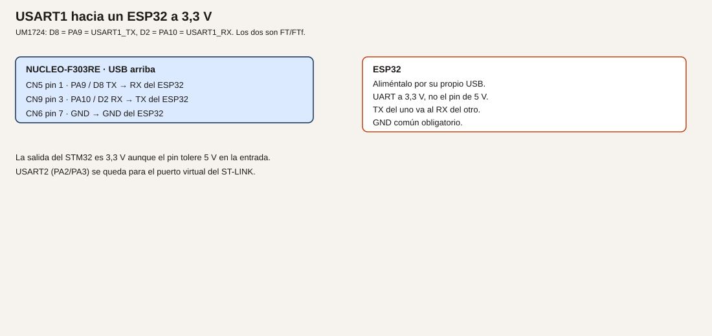

# Módulo 7. UART y terminal serie

Hasta aquí los números se leían con el programa parado. Un UART envía y recibe bytes mientras el programa sigue. En la placa hay dos caminos distintos: USART2 hacia el PC por el ST-LINK, y USART1 hacia otra placa de 3,3 V.

**No comprobado en hardware.** Las velocidades y el formato son los que configuras. No se midió el enlace al redactar esto.

## Objetivos

- Enviar una línea por el puerto COM virtual al arrancar.
- Recibir un carácter y devolverlo, y usar otro carácter para conmutar LD2.
- Cruzar TX y RX con un ESP32 a 3,3 V, con GND común, sin soldar SB62 ni SB63.

## Prerrequisitos

Módulos 3 a 6. Para el ejemplo 3, un ESP32 u otra placa cuya UART sea de 3,3 V, alimentada por su propio USB.

## Dos UART, dos destinos

**Analogía.** El puerto serie es un tubo de mensajes de texto entre dos puestos. Si los dos hablan a la vez por el mismo tubo, no se entiende. Por eso el aviso al PC y el aviso a la otra placa van por tubos distintos. Los hilos se cruzan: lo que uno transmite, el otro lo recibe. La masa tiene que ser la misma, como la referencia de un lazo de corriente.

**Técnico. Verificado en UM1724.**

- USART2 usa PA2 (TX) y PA3 (RX). Con SB13 y SB14 cerrados, que es el defecto de la tabla 10, esos pines van al ST-LINK y aparecen en el PC como un puerto COM virtual. SB62 y SB63 abiertos: PA2 y PA3 no están en D1 ni en D0. No los sueldes en este módulo.
- USART1 usa PA9 (TX, D8, CN5 pin 1) y PA10 (RX, D2, CN9 pin 3). Los dos son FTf. La tabla 19 admite en un pin FT hasta 5,5 V en la entrada. La salida del STM32 sigue siendo 3,3 V.
- El formato de este curso es 8N1: 8 bits de dato, sin paridad, 1 bit de parada. La velocidad del ejemplo es 115200 bit/s. Tiene que ser la misma en CubeMX y en el monitor.

El monitor serie integrado de la extensión sirve. Cualquier otro monitor a 115200 8N1 también, si no está abierto a la vez que el depurador se queda el puerto: ciérralo antes de grabar si el sistema se queja de que el COM está ocupado.

## Ejemplo 1. Una línea al arrancar, por USART2

1. **Problema.** Saber que el programa llegó al bucle sin parar el depurador.
2. **Objetivo.** Escribir `nucleo lista` una vez, por el puerto virtual.
3. **Material.** La placa y el PC. Nada en D0 ni en D1.
4. **Funcionamiento.** `HAL_UART_Transmit` manda los bytes por PA2 hacia el ST-LINK, que los convierte en USB. El PC los muestra como texto.
5. **Dibujo.** No hay cableado externo. El camino PA2/PA3 está en la tarjeta, por SB13 y SB14.
6. **Cableado.** Solo CN1 al PC.

| Señal | ¿Sale al Arduino? | Uso |
| --- | --- | --- |
| PA2 USART2_TX | No, mientras SB62 esté abierto | Hacia el ST-LINK |
| PA3 USART2_RX | No, mientras SB63 esté abierto | Desde el ST-LINK |

7. **Cálculos.** 115200 bit/s, 8N1, son 10 símbolos por byte si cuentas el bit de arranque. Un byte tarda unos 87 µs. No hace falta medirlo para este ejemplo.
8. **CubeMX.** Activa USART2 en modo asíncrono si la placa no lo dejó ya así. 115200, 8 bits, sin paridad, 1 bit de parada. Pines PA2 y PA3. No actives el puerto en D0/D1. Genera.
9. **Código.**

```c
/* USER CODE BEGIN 2 */
static const uint8_t aviso[] = "nucleo lista\r\n";
HAL_UART_Transmit(&huart2, (uint8_t *)aviso, sizeof(aviso) - 1U, 100);
/* USER CODE END 2 */
```

`USER CODE BEGIN 2` está después de la inicialización y antes del bucle. `sizeof` cuenta el cero final de la cadena: se resta 1 para no enviarlo.

10. **Dónde.** `Core/Src/main.c`, zona 2. La variable `huart2` la declara CubeMX.
11. **Compilar y probar.** Build, graba, abre el monitor serie a 115200 8N1 en el COM del ST-LINK. Pulsa reset (B2) para ver la línea otra vez.
12. **Esperado, no medido.** Aparece `nucleo lista` una vez por cada arranque. LD2 puede quedar como lo dejara el módulo anterior.
13. **Fallos.** Ningún COM: controlador ST-LINK, o el cable no tiene datos. Texto ilegible: la velocidad o el 8N1 no coinciden. Nada en pantalla y el COM existe: estás en otro puerto, o SB13/SB14 están abiertos. No sueldes SB62 para «arreglarlo».
14. **Variación.** Manda la misma línea también dentro del `while`, cada segundo, con `HAL_Delay(1000)`. Verás que el retardo bloquea. Se quitará en el módulo 8.
15. **Criterio.** La línea coincide con el texto del programa y con la velocidad del monitor.

## Ejemplo 2. Eco y un carácter que conmuta LD2

1. **Problema.** El enlace de ida no demuestra que la placa reciba.
2. **Objetivo.** Cada carácter recibido se devuelve. La letra `l` conmuta LD2.
3. **Material.** El mismo puerto virtual.
4. **Funcionamiento.** `HAL_UART_Receive` espera un byte en PA3, con un tiempo máximo. Si llega, se reenvía por PA2. Si es `l`, se cambia PA5.
5. **Dibujo.** No hay cableado nuevo.
6. **Cableado.** El del ejemplo 1.
7. **Cálculos.** El tiempo de espera de 20 ms es de diseño, para no quedarse bloqueado del todo si no llega nada. Sigue siendo una espera corta dentro del bucle.
8. **CubeMX.** El mismo USART2.
9. **Código.**

```c
/* USER CODE BEGIN WHILE */
while (1)
{
  uint8_t letra = 0U;
  if (HAL_UART_Receive(&huart2, &letra, 1U, 20) == HAL_OK)
  {
    HAL_UART_Transmit(&huart2, &letra, 1U, 20);
    if (letra == (uint8_t)'l')
    {
      HAL_GPIO_TogglePin(GPIOA, GPIO_PIN_5);
    }
  }
  /* USER CODE END WHILE */
```

10. **Dónde.** El bucle. Puedes dejar el aviso del ejemplo 1 en la zona 2.
11. **Compilar y probar.** Monitor a 115200 8N1. Escribe `hola` y después `l`.
12. **Esperado, no medido.** El monitor muestra lo que escribes. Cada `l` cambia LD2. Otras letras solo se devuelven.
13. **Fallos.** No vuelve el eco: el monitor no envía al pulsar la tecla, o el RX del ST-LINK no está en SB14. `l` no cambia el LED: el programa compara otra letra, o PA5 no es salida. Caracteres doblados: el monitor hace eco local y además la placa devuelve el byte. Desactiva el eco local.
14. **Variación.** Usa `e` para encender y `a` para apagar, con `HAL_GPIO_WritePin`, en vez de conmutar.
15. **Criterio.** Distingues el eco de la orden del LED, y no has movido SB62 ni SB63.

## Ejemplo 3. USART1 hacia un ESP32 a 3,3 V

1. **Problema.** Hablar con otra placa sin ocupar el puerto del PC.
2. **Objetivo.** El STM32 envía `ping` por USART1 y muestra por USART2 lo que el ESP32 conteste.
3. **Material.** ESP32 alimentado por su USB. Cables de señal y un GND común. Los dos lados a 3,3 V.
4. **Funcionamiento.** TX de uno va a RX del otro. USART2 sigue siendo el informe hacia el PC. Si el otro UART fuera de 5 V, la entrada FT del STM32 lo admitiría como máximo absoluto, pero la salida de 3,3 V puede no ser un «uno» válido para un receptor alimentado a 5 V. Este ejemplo no usa desplazador porque los dos lados son 3,3 V. Si tu módulo no lo es, no lo conectes: hace falta un desplazador, y esta lección no lo cablea.
5. **Dibujo.**



6. **Cableado.**

| Origen en la Nucleo | Destino |
| --- | --- |
| CN5 pin 1, PA9 / D8, TX | RX del ESP32 |
| CN9 pin 3, PA10 / D2, RX | TX del ESP32 |
| CN6 pin 6 o 7, GND | GND del ESP32 |

El ESP32 no se alimenta desde un GPIO ni hace falta tomarlo de CN6 pin 4. Usa su propio USB. No conectes el pin de 5 V del ESP32 a PA9 ni a PA10.

7. **Cálculos.** La misma velocidad en los dos programas: 115200 8N1.
8. **CubeMX.** Añade USART1 asíncrono en PA9 y PA10, 115200 8N1. Deja USART2 como estaba. Genera.
9. **Código.** En el STM32:

```c
/* USER CODE BEGIN 2 */
static const uint8_t ping[] = "ping\r\n";
HAL_UART_Transmit(&huart1, (uint8_t *)ping, sizeof(ping) - 1U, 100);
/* USER CODE END 2 */
```

```c
/* USER CODE BEGIN WHILE */
while (1)
{
  uint8_t byte = 0U;
  if (HAL_UART_Receive(&huart1, &byte, 1U, 20) == HAL_OK)
  {
    HAL_UART_Transmit(&huart2, &byte, 1U, 20);
  }
  /* USER CODE END WHILE */
```

En el ESP32, un programa que escuche el UART a 115200 y responda `pong` basta. El texto del ESP32 no forma parte de este repositorio: escríbelo en el entorno de esa placa y confirma que su UART de 3,3 V es el que cableaste.

10. **Dónde.** `huart1` lo crea CubeMX. El STM32 se programa en `main.c`. El informe al PC sigue saliendo por `huart2`.
11. **Compilar y probar.** Graba el STM32. Abre el monitor del COM virtual. Alimenta el ESP32. Pulsa reset en la Nucleo para repetir el `ping`.
12. **Esperado, no medido.** Lo que el ESP32 envíe aparece en el monitor del PC. Si todavía no hay programa en el ESP32, no aparecerá `pong`: eso no es un fallo del cable hasta que el otro lado transmita.
13. **Fallos.** Nada, con el ESP32 ya transmitiendo: TX y RX no están cruzados, o falta el GND. Caracteres basura: velocidades distintas. La placa del STM32 se calienta o el pin no responde: había 5 V en el cable de señal. Quita esa conexión.
14. **Variación.** No dejes el ESP32 conectado cuando llegues al módulo 21. PA9 y PA10 pasan a ser el Modbus. Son usos alternativos, no simultáneos.
15. **Criterio.** USART2 sigue libre para el PC y USART1 es el enlace externo, a 3,3 V, con GND común.

## Resumen

115200 8N1 en los dos extremos. USART2 es el COM del ST-LINK y no se mueve a D0/D1. USART1 cruza TX/RX con otra placa de 3,3 V.

## Glosario

| Término | Definición |
| --- | --- |
| UART | Envío y recepción de bytes sin reloj compartido |
| 8N1 | 8 bits, sin paridad, un bit de parada |
| Puerto virtual | El COM que el ST-LINK crea en el PC a partir de USART2 |
| Tierra común | El GND de las dos placas unido |
| Bit de arranque | El símbolo que precede a cada byte en el UART |

## Preguntas

**1.** ¿PA9 a 3,3 V garantiza que un receptor de 5 V lo entienda?

Respuesta. No. La entrada FT admite 5 V. La salida no se convierte en 5 V.

**2.** ¿Por qué no se cierran SB62 y SB63?

Respuesta. Porque entonces PA2 y PA3 también aparecerían en D1 y D0, y este curso los reserva al ST-LINK.

**3.** ¿Puedo usar PA9 a la vez para el ESP32 y para el Modbus del módulo 21?

Respuesta. No. Hay que desconectar el ESP32 antes de ese módulo.

## Lista de comprobación

- [ ] `nucleo lista` sale a 115200 8N1 por el COM virtual.
- [ ] El eco funciona y `l` cambia LD2.
- [ ] El ESP32, si lo monté, está a 3,3 V, con TX/RX cruzados y GND común.

## Siguiente

[Módulo 8](09-modulo-08-temporizadores.md): dejar de usar `HAL_Delay` como forma de llevar el tiempo.
