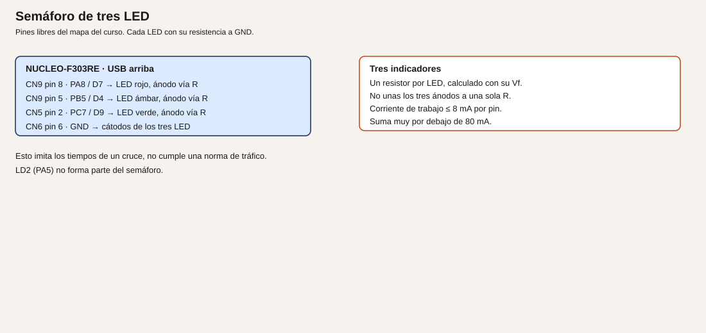

# Módulo 8. Temporizadores y programas que no se bloquean

`HAL_Delay` deja el procesador quieto. Un semáforo que además tiene que atender un pulsador no puede vivir dentro de esa espera. El tiempo pasa en un temporizador y el bucle solo pregunta si ya toca cambiar.

**No comprobado en hardware.** El reloj de 72 MHz es el que debes ver en CubeMX al elegir esta placa, no una medida de frecuencia.

## Objetivos

- Conmutar LD2 sin `HAL_Delay` en el lazo.
- Montar un semáforo de tres LED con tiempos en milisegundos.
- Medir el intervalo entre dos pulsaciones de B1 y escribirlo por USART2.

## Prerrequisitos

Módulos 5 y 7. Tres LED con su resistencia cada uno, si haces el ejemplo 2. Esos tres LED no conviven con el relé del módulo 10: PB5 es el ámbar aquí y la base del transistor allí. Son montajes alternativos.

## El tiempo en el chip

**Analogía.** `HAL_Delay` es mirar el reloj de pared sin hacer otra cosa hasta que pase el minuto. Un temporizador es el reloj que sigue andando mientras atiendes el teléfono. El programa mira el reloj cuando puede.

**Técnico.** `HAL_GetTick` cuenta milisegundos con el SysTick. Para este módulo basta, y es un temporizador del núcleo, no un retardo vacío escrito a mano. TIM2 es el temporizador de 32 bits de este chip (datasheet, tabla 2). TIM3 tiene el canal 2 en PC7 (datasheet, tabla 13, y UM1724 tabla 14: D9). Ese canal se usará en el módulo 10 para PWM. Aquí PC7 es todavía GPIO.

En la placa C-02 o posterior, el reloj de sistema previsto es HSE de 8 MHz por el MCO del ST-LINK en PF0, PLL a 72 MHz, APB1 a 36 MHz y APB2 a 72 MHz. Confírmalo en la pestaña *Clock*. Si APB1 está dividido, el reloj de un temporizador de APB1 queda al doble de PCLK1: a 72 MHz. Es la regla del reloj de timers del manual de referencia; confírmala en RM0316 y en la pantalla de CubeMX. No está medida en esta redacción.

## Ejemplo 1. Parpadeo sin bloquear el bucle

1. **Problema.** Mientras `HAL_Delay` espera, el programa no puede leer un pulsador ni atender el UART.
2. **Objetivo.** Conmutar PA5 cada 500 ms y, en el mismo bucle, seguir recibiendo por USART2.
3. **Material.** La placa y el monitor serie del módulo 7.
4. **Funcionamiento.** Se guarda el milisegundo de la última conmutación. Cuando la diferencia llega a 500, se conmuta y se actualiza la marca. El restar dos `uint32_t` de `HAL_GetTick` tolera el desbordamiento del contador.
5. **Dibujo.** No hay cableado nuevo.
6. **Cableado.** Solo USB.
7. **Cálculos.** 500 ms es el semiperiodo elegido. En un minuto habría unas 60 conmutaciones de encendido. No se ha cronometrado.
8. **CubeMX.** PA5 salida. USART2 a 115200 8N1, como en el módulo 7. SysTick como fuente de tiempo del HAL, que es lo habitual al generar el proyecto.
9. **Código.**

```c
/* USER CODE BEGIN WHILE */
while (1)
{
  static uint32_t marca = 0U;
  uint8_t letra = 0U;
  if ((HAL_GetTick() - marca) >= 500U)
  {
    marca = HAL_GetTick();
    HAL_GPIO_TogglePin(GPIOA, GPIO_PIN_5);
  }
  if (HAL_UART_Receive(&huart2, &letra, 1U, 0) == HAL_OK)
  {
    HAL_UART_Transmit(&huart2, &letra, 1U, 10);
  }
  /* USER CODE END WHILE */
```

El tiempo de espera 0 en `Receive` significa: si no hay byte, sigue. No llama a `HAL_Delay`.

10. **Dónde.** El bucle de `main.c`.
11. **Compilar y probar.** Monitor a 115200. Escribe mientras LD2 cambia.
12. **Esperado, no medido.** El eco responde también entre dos cambios del LED. El periodo visible es del orden de medio segundo por estado. No hay una captura de osciloscopio en este texto.
13. **Fallos.** El LED no conmuta: `marca` se actualiza siempre, no solo cuando vence el tiempo. Revisa el `if`. El eco tarda medio segundo: quedó un `HAL_Delay` o un `Receive` con espera larga.
14. **Variación.** Cambia 500 por 100. El bucle no se reescribe: solo el umbral.
15. **Criterio.** No hay `HAL_Delay` en el `while`, y el UART sigue respondiendo.

## Ejemplo 2. Semáforo de tres luces

1. **Problema.** Tres pilotos con tiempos distintos no caben en una cadena de retardos si más adelante hay que leer un pulsador.
2. **Objetivo.** Rojo, ámbar y verde, un solo encendido a la vez, con tiempos de un cruce de juguete.
3. **Material.** Tres LED y tres resistencias, calculadas como en el módulo 5. Ejemplo si Vf = 2,0 V e If = 5 mA: 270 Ω cada una. Recalcula con tu hoja.
4. **Funcionamiento.** Una fase tiene un pin encendido y una duración. Al vencer, se pasa a la fase siguiente. Solo hay un LED encendido, así que la corriente de salida es la de un pin, no la de tres.
5. **Dibujo.**



6. **Cableado.**

| Luz | Conector | Señal | Destino |
| --- | --- | --- | --- |
| Rojo | CN9 pin 8 | PA8 / D7 | Resistencia y ánodo |
| Ámbar | CN9 pin 5 | PB5 / D4 | Resistencia y ánodo |
| Verde | CN5 pin 2 | PC7 / D9 | Resistencia y ánodo |
| Cátodos | CN6 pin 6 o 7 | GND | Los tres |

PA8 aquí es salida. No dejes montado a la vez el pulsador externo del módulo 5, que usaba PA8 como entrada. PB5 no lleva a la vez la base del transistor del módulo 10.

7. **Cálculos.** Tiempos de juguete, no una norma de tráfico: rojo 4000 ms, ámbar 1000 ms, verde 4000 ms. If de cada LED, con 270 Ω y el supuesto de arriba, unos 4,8 mA.
8. **CubeMX.** PA8, PB5 y PC7 como `GPIO_Output`, push-pull, sin pull, velocidad baja. Etiquetas `ROJO`, `AMBAR`, `VERDE`.
9. **Código.**

```c
/* USER CODE BEGIN 0 */
static void luces(uint8_t rojo, uint8_t ambar, uint8_t verde)
{
  HAL_GPIO_WritePin(GPIOA, GPIO_PIN_8, rojo ? GPIO_PIN_SET : GPIO_PIN_RESET);
  HAL_GPIO_WritePin(GPIOB, GPIO_PIN_5, ambar ? GPIO_PIN_SET : GPIO_PIN_RESET);
  HAL_GPIO_WritePin(GPIOC, GPIO_PIN_7, verde ? GPIO_PIN_SET : GPIO_PIN_RESET);
}
/* USER CODE END 0 */
```

```c
/* USER CODE BEGIN WHILE */
while (1)
{
  static uint8_t fase = 0U;
  static uint32_t marca = 0U;
  static const uint32_t duracion[] = {4000U, 1000U, 4000U};
  if ((HAL_GetTick() - marca) >= duracion[fase])
  {
    marca = HAL_GetTick();
    fase++;
    if (fase > 2U)
    {
      fase = 0U;
    }
  }
  if (fase == 0U) { luces(1U, 0U, 0U); }
  if (fase == 1U) { luces(0U, 1U, 0U); }
  if (fase == 2U) { luces(0U, 0U, 1U); }
  /* USER CODE END WHILE */
```

10. **Dónde.** `luces` en `USER CODE BEGIN 0`. El bucle en `main.c`.
11. **Compilar y probar.** Graba y observa el orden rojo, ámbar, verde.
12. **Esperado, no medido.** Nunca hay dos LED del semáforo encendidos. El orden se repite. LD2 no forma parte del semáforo.
13. **Fallos.** Dos luces a la vez: un cátodo no va a GND y el LED encuentra otro camino, o `luces` no apaga las otras. Ninguna luz: las tres resistencias no están, o los pines no son salidas. Ámbar en el pin del relé: desmonta uno de los dos antes de seguir.
14. **Variación.** Añade una fase rojo+ámbar, de 1000 ms, como cuarto estado. El módulo 17 la escribirá como máquina de estados con nombre.
15. **Criterio.** Los tiempos están en la tabla `duracion` y el bucle no llama a `HAL_Delay`.

## Ejemplo 3. Tiempo entre dos pulsaciones de B1

1. **Problema.** Quieres medir un intervalo sin un cronómetro externo.
2. **Objetivo.** Al soltar la segunda pulsación de B1, USART2 escribe los milisegundos desde la anterior.
3. **Material.** B1 y el monitor serie. PC13 solo se lee.
4. **Funcionamiento.** En cada flanco a pulsado (nivel bajo estable) se resta la marca anterior de `HAL_GetTick`. TIM2 podría contar lo mismo en microsegundos; para un dedo, el milisegundo del SysTick sobra y el código se lee mejor. Se dice aquí para no presentar el SysTick como si fuera el único temporizador del chip.
5. **Dibujo.** No hay cableado nuevo.
6. **Cableado.** B1 interno. USART2 por el ST-LINK.

| Señal | Uso |
| --- | --- |
| PC13 | Entrada, activa a bajo |
| PA2/PA3 | Texto hacia el PC |

7. **Cálculos.** El filtro de 20 ms es el del módulo 5. Un intervalo de 1 s debe imprimirse cerca de 1000. La exactitud del SysTick depende del reloj de 72 MHz configurado, no de una calibración hecha en este texto.
8. **CubeMX.** PC13 entrada. USART2 115200 8N1. Opcional: activa TIM2 como temporizador interno, sin pin, para verlo en el árbol. No es imprescindible para este listado.
9. **Código.**

```c
/* USER CODE BEGIN PV */
static uint32_t marca_b1;
static uint8_t hay_marca;
/* USER CODE END PV */
```

```c
/* USER CODE BEGIN 0 */
static uint8_t b1_estable(void)
{
  static uint8_t aceptado = 1U;
  static uint32_t desde = 0U;
  uint8_t ahora = (HAL_GPIO_ReadPin(GPIOC, GPIO_PIN_13) == GPIO_PIN_RESET) ? 0U : 1U;
  if (ahora == aceptado)
  {
    desde = 0U;
    return aceptado;
  }
  if (desde == 0U)
  {
    desde = HAL_GetTick();
    return aceptado;
  }
  if ((HAL_GetTick() - desde) >= 20U)
  {
    aceptado = ahora;
    desde = 0U;
  }
  return aceptado;
}
/* USER CODE END 0 */
```

```c
/* USER CODE BEGIN WHILE */
while (1)
{
  static uint8_t anterior = 1U;
  uint8_t ahora = b1_estable();
  if ((anterior == 1U) && (ahora == 0U))
  {
    uint32_t t = HAL_GetTick();
    if (hay_marca)
    {
      char linea[40];
      int n = snprintf(linea, sizeof(linea), "intervalo %lu ms\r\n",
                       (unsigned long)(t - marca_b1));
      if (n > 0)
      {
        HAL_UART_Transmit(&huart2, (uint8_t *)linea, (uint16_t)n, 50);
      }
    }
    marca_b1 = t;
    hay_marca = 1U;
  }
  anterior = ahora;
  /* USER CODE END WHILE */
```

Hace falta `#include <stdio.h>` en `USER CODE BEGIN Includes`.

10. **Dónde.** `main.c`, zonas Includes, PV, 0 y el bucle.
11. **Compilar y probar.** Monitor serie. Pulsa B1 dos veces, con una pausa clara.
12. **Esperado, no medido.** La primera pulsación no imprime intervalo. La segunda imprime la diferencia. El número debe parecerse al tiempo que contaste. Anota el tuyo: este texto no trae una medida.
13. **Fallos.** Siempre 0: la marca se actualiza antes de restar. Revisa el orden. Números de unas decenas de ms al mantener pulsado: estás contando rebotes. El filtro de 20 ms tiene que seguir delante. Nada en el monitor: USART2 o la velocidad.
14. **Variación.** Ignora intervalos menores de 100 ms además del filtro, por si el dedo rebota más que 20 ms.
15. **Criterio.** El intervalo sale por USART2 y PC13 no se ha puesto como salida.

## Resumen

El bucle mira `HAL_GetTick` y no se duerme en `HAL_Delay`. El semáforo es una fase y una tabla de tiempos. El intervalo entre pulsaciones se imprime.

## Glosario

| Término | Definición |
| --- | --- |
| SysTick | Contador del núcleo que el HAL usa para los milisegundos |
| TIM2 | Temporizador de 32 bits de este STM32 |
| Periodo | Tiempo entre dos sucesos iguales |
| Fase | Un estado del semáforo con una duración |

## Preguntas

**1.** ¿Quitar `HAL_Delay` apaga el temporizador?

Respuesta. No. Deja de bloquear el bucle. El tiempo sigue en el SysTick.

**2.** ¿Puedo dejar el ámbar en PB5 y a la vez el transistor del módulo 10?

Respuesta. No. Es el mismo pin. Se monta uno u otro.

**3.** ¿Estos tiempos de semáforo cumplen una norma de tráfico?

Respuesta. No. Son un ejemplo de programa.

## Lista de comprobación

- [ ] LD2 conmuta y el UART responde en el mismo bucle, sin `HAL_Delay`.
- [ ] Hay una resistencia por LED del semáforo.
- [ ] He leído un intervalo entre dos pulsaciones de B1.

## Siguiente

[Módulo 9](10-modulo-09-interrupciones.md): atender el flanco cuando ocurre, no en la siguiente vuelta del bucle.
