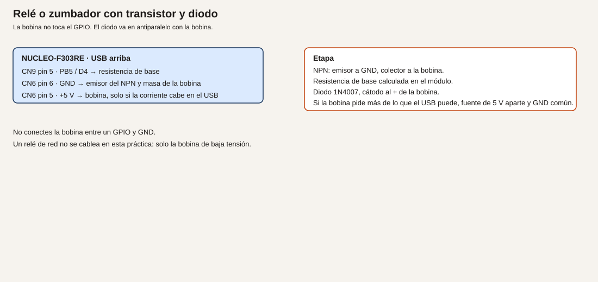
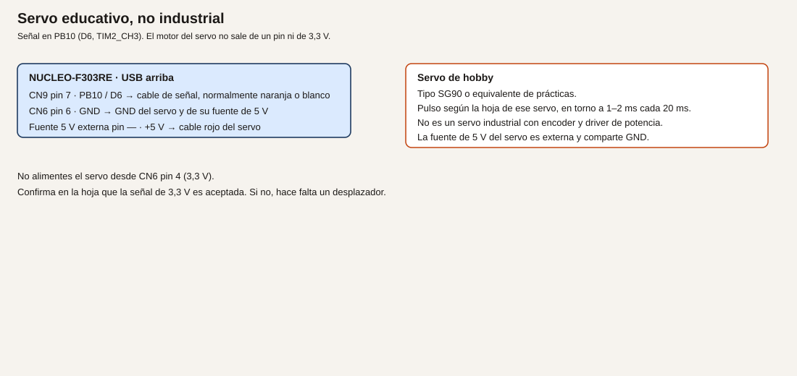

# Módulo 10. PWM y cargas con etapa externa

Un pin a nivel alto fijo entrega o no entrega. Un PWM enciende y apaga tan rápido que el LED parece más o menos brillante. Una bobina o un servo no se cuelgan del pin: la corriente gorda va por otro camino.

**No comprobado en hardware.** Los tiempos de servo son los de una hoja típica de hobby. Confírmalos en la hoja del servo que compres.

## Objetivos

- Generar un PWM en PC7 con TIM3 canal 2.
- Activar una bobina de baja tensión con transistor, resistencia de base y diodo.
- Mandar un servo educativo por PB10, con el motor alimentado aparte.

## Prerrequisitos

Módulos 2, 5 y 8. LED y resistencia. Para el ejemplo 2, un NPN de pequeña señal (2N2222 o equivalente), 1 kΩ de base como punto de partida del cálculo, un 1N4007 y un zumbador o la bobina de un relé de 5 V. Para el ejemplo 3, un servo de hobby tipo SG90 y una fuente de 5 V externa.

El semáforo del módulo 8 usa PA8, PB5 y PC7. Este módulo usa PC7 para el PWM del LED y PB5 para la base del transistor. No montes el semáforo y el relé a la vez. El servo usa PB10, que en el mapa estaba libre.

## PWM, transistor y servo

**Analogía.** El PWM es un interruptor que cicles tú muy deprisa. La fracción del tiempo encendido es el brillo, como un grifo que no se queda a medias: se abre y se cierra, y el vaso se llena más o menos según el tiempo abierto. El transistor es el contactor que aguanta la bobina. El diodo es el camino de la corriente cuando el contactor abre, para que esa corriente no busque el transistor. El servo de aeromodelismo no es un servo de máquina: es un motor pequeño con su propia electrónica, que obedece la anchura de un pulso.

**Técnico.**

- PC7, CN5 pin 2, D9, es TIM3_CH2 (datasheet, tabla 13; UM1724, tabla 14). Tipo FT. La salida sigue a 3,3 V.
- PB10, CN9 pin 7, D6, es TIM2_CH3 (UM1724, tabla 14).
- TIM3 y TIM2 cuelgan de APB1. Con el reloj de la placa a 72 MHz de sistema y APB1 a 36 MHz, el reloj del timer queda a 72 MHz si se cumple la regla del manual. Confírmalo en CubeMX. No está medido aquí.
- La bobina no se conecta a un GPIO. El máximo absoluto de un pin es 25 mA y la suma es 80 mA (datasheet, tabla 17). El diseño de este curso se queda en unos 8 mA por pin.

El servo es educativo. El pulso habitual de un SG90 está entre 1 ms y 2 ms, repetido cada 20 ms. Confírmalo en tu hoja. La alimentación del motor es de 5 V por un cable distinto. No sale de un GPIO ni del pin de 3,3 V. Confirma también que ese servo acepta una señal de 3,3 V. Si la hoja pide 5 V en la señal, hace falta un desplazador, y no se conecta PB10 directo.

## Ejemplo 1. Brillo del LED en PC7

1. **Problema.** Encendido y apagado no permiten un aviso «a medias».
2. **Objetivo.** Tres brillos distintos en el LED externo, por PWM, a una frecuencia que no se vea parpadear.
3. **Material.** El LED y su resistencia del módulo 5, en PC7. Ejemplo de cálculo: 270 Ω si Vf = 2,0 V e If = 5 mA.
4. **Funcionamiento.** El timer repite un periodo. El canal mantiene la salida a nivel alto durante una fracción de ese periodo. El ojo integra el parpadeo si la frecuencia es alta. A 1 kHz el periodo es 1 ms, por encima de un parpadeo visible.
5. **Dibujo.** El mismo que el LED del módulo 5: [cable-led-pc7.svg](img/cable-led-pc7.svg).
6. **Cableado.** CN5 pin 2 (PC7) a la resistencia y al ánodo. Cátodo a GND. No dejes PA8 y PB5 del semáforo montados si vas a reutilizar esos pines después.
7. **Cálculos.** Reloj del timer 72 MHz. Periodo de 1 ms: hace falta contar 72000 ciclos. El contador es de 16 bits (hasta 65535), así que se preescala. Prescaler 72 − 1 = 71: el contador va a 1 MHz. Periodo 1000 − 1 = 999: 1 ms, o sea 1 kHz. Un pulso de 100 cuentas es el 10 % del periodo. Uno de 500 es el 50 %. Estos números son de diseño, con el reloj supuesto de CubeMX. Si tu reloj no es 72 MHz, no uses estas cuentas.
8. **CubeMX.** TIM3, reloj interno, canal 2 en PWM generation CH2, pin PC7. Prescaler 71, counter period 999, pulse del canal 100 para empezar. No actives el canal en otro pin.
9. **Código.**

```c
/* USER CODE BEGIN 2 */
HAL_TIM_PWM_Start(&htim3, TIM_CHANNEL_2);
__HAL_TIM_SET_COMPARE(&htim3, TIM_CHANNEL_2, 100);
/* USER CODE END 2 */
```

```c
/* USER CODE BEGIN WHILE */
while (1)
{
  __HAL_TIM_SET_COMPARE(&htim3, TIM_CHANNEL_2, 100);
  HAL_Delay(1000);
  __HAL_TIM_SET_COMPARE(&htim3, TIM_CHANNEL_2, 500);
  HAL_Delay(1000);
  __HAL_TIM_SET_COMPARE(&htim3, TIM_CHANNEL_2, 900);
  HAL_Delay(1000);
  /* USER CODE END WHILE */
```

Aquí `HAL_Delay` solo separa los tres brillos para que los veas. No es quien genera el PWM.

10. **Dónde.** `main.c`. `htim3` lo crea CubeMX.
11. **Compilar y probar.** Graba y observa el LED externo. LD2 no tiene por qué cambiar.
12. **Esperado, no medido.** Tres brillos crecientes, cambiando cada segundo. A 1 kHz no debes ver el parpadeo del PWM. Si tienes osciloscopio, en CN5 pin 2 verías un cuadrado de 1 kHz. Esa captura no está en este texto.
13. **Fallos.** LED fijo: el canal no está arrancado, o el compare vale 0 o 999 todo el rato. Frecuencia rara: el prescaler no cuadra con tu reloj. LED en LD2 en vez del externo: el PWM se quedó en PA5. PA5 no es el canal de esta práctica.
14. **Variación.** Periodo 100 (100 µs de cuenta a 1 MHz, 10 kHz) si quieres más margen sobre el parpadeo. Recalcula el compare para el mismo porcentaje.
15. **Criterio.** Sabes qué cuentas son el 10 % y cuáles el periodo, y el LED no va sin resistencia.

## Ejemplo 2. Transistor, diodo y bobina de 5 V

1. **Problema.** Un relé o un zumbador de 5 V pide más corriente de la que conviene sacar de un pin, y además es una carga inductiva.
2. **Objetivo.** Encender y apagar esa carga desde PB5, sin que la bobina toque el GPIO.
3. **Material.** NPN, resistencia de base, 1N4007, zumbador o relé de 5 V cuya bobina quepa en el presupuesto. Si la bobina pide más de lo que el USB puede dar con JP1 abierto (la placa pide 300 mA, UM1724 §7.5), usa una fuente de 5 V aparte y une los GND.
4. **Funcionamiento.** PB5, a través de la resistencia, mete corriente en la base. El transistor cierra el circuito de la bobina hacia GND. Al abrir, el diodo conduce la corriente de la bobina. El cátodo del diodo mira al positivo de la bobina.
5. **Dibujo.**



6. **Cableado.**

| Origen | Destino |
| --- | --- |
| CN9 pin 5, PB5 / D4 | Resistencia de base, y de ahí a la base del NPN |
| Emisor del NPN | CN6 pin 6, GND |
| Colector | Un extremo de la bobina |
| El otro extremo de la bobina | CN6 pin 5 (+5 V), solo si la corriente cabe; si no, +5 V externo |
| 1N4007 | En paralelo con la bobina, cátodo al lado de +5 V |
| GND externo, si lo hay | GND de la placa |

No montes el LED ámbar del semáforo en PB5 a la vez. No conectes la bobina entre PB5 y GND. No uses un relé de red: esta práctica es la bobina de baja tensión.

7. **Cálculos.** Ejemplo de diseño, no una medida. Supón una bobina de 5 V y 40 mA, y un transistor con ganancia mínima 100. La base necesita 40 mA / 100 = 0,4 mA. Con el pin a 3,3 V y Vbe ≈ 0,7 V, Rbase = (3,3 − 0,7) / 0,0004 = 6500 Ω. Un valor más bajo asegura la saturación: 1 kΩ da (3,3 − 0,7) / 1000 = 2,6 mA de base, dentro de los 8 mA del pin. Usa la corriente de tu bobina y la ganancia de tu hoja. Si Ib sale por encima de 8 mA, el transistor no vale para gobernarlo así: hace falta otra etapa, y este módulo no la da. Potencia en 1 kΩ: muy por debajo de 1/4 W.
8. **CubeMX.** PB5 `GPIO_Output`. El PWM de PC7 puede quedarse.
9. **Código.**

```c
/* USER CODE BEGIN WHILE */
while (1)
{
  HAL_GPIO_WritePin(GPIOB, GPIO_PIN_5, GPIO_PIN_SET);
  HAL_Delay(500);
  HAL_GPIO_WritePin(GPIOB, GPIO_PIN_5, GPIO_PIN_RESET);
  HAL_Delay(500);
  /* USER CODE END WHILE */
```

10. **Dónde.** El bucle. Quita este `HAL_Delay` cuando vuelvas a un programa que no pueda bloquearse.
11. **Compilar y probar.** Graba. La carga debe activarse y parar cada medio segundo.
12. **Esperado, no medido.** El zumbador suena a rachas, o el relé de baja tensión cambia. El GPIO no se calienta. Si mides la base, la corriente debe parecerse a tu cálculo. Anótala como tuya.
13. **Fallos.** No actúa y el transistor se calienta: emisor y colector cambiados, o no hay diodo y ya se dañó al cortar. Actúa siempre: PB5 está a 1 fijo, o el transistor está en corto. La placa se cae: la bobina supera el presupuesto del USB. Pásala a fuente externa.
14. **Variación.** Gobierna la base con un PWM lento solo si la hoja de la carga lo permite. Un relé no se trocea a 1 kHz.
15. **Criterio.** La bobina no tiene ningún hilo en el GPIO. El diodo está puesto. La corriente de base está calculada con tu hoja.

## Ejemplo 3. Servo educativo en PB10

1. **Problema.** Situar un mecanismo pequeño sin confundirlo con un servo industrial.
2. **Objetivo.** Tres posiciones con pulsos de 1,0 ms, 1,5 ms y 2,0 ms, cada 20 ms, en PB10.
3. **Material.** Servo tipo SG90 o el que indique tu hoja. Fuente de 5 V para el motor, externa. Cables.
4. **Funcionamiento.** TIM2 canal 3 genera un periodo de 20 ms y un pulso de la anchura pedida. El servo lee esa anchura. El motor se alimenta de la fuente de 5 V, no de PB10 y no de 3,3 V.
5. **Dibujo.**



6. **Cableado.**

| Hilo habitual | Destino |
| --- | --- |
| Señal (a menudo naranja o blanco) | CN9 pin 7, PB10 / D6 |
| Negativo (a menudo marrón o negro) | GND de la fuente y GND de la placa (CN6 pin 6) |
| Positivo del motor (a menudo rojo) | +5 V de la fuente externa, no CN6 pin 4 |

Confirma los colores en tu hoja. No son una norma.

7. **Cálculos.** Periodo 20 ms con el timer a 1 MHz: 20000 cuentas, que no caben en 16 bits. Prescaler (72 − 1) = 71 deja 1 MHz. Sigue sin caber 20000. Prescaler 144 − 1 = 143 deja 0,5 MHz, y 20 ms son 10000 cuentas. Pulse de 1,0 ms = 500 cuentas; 1,5 ms = 750; 2,0 ms = 1000. Counter period = 10000 − 1 = 9999. Esto supone reloj de timer a 72 MHz. Confírmalo. Los milisegundos del pulso tienen que coincidir con tu hoja: si pide otro margen, cambia las cuentas, no el pin.
8. **CubeMX.** TIM2, canal 3 PWM en PB10. Prescaler 143, counter period 9999, pulse inicial 750.
9. **Código.**

```c
/* USER CODE BEGIN 2 */
HAL_TIM_PWM_Start(&htim2, TIM_CHANNEL_3);
/* USER CODE END 2 */
```

```c
/* USER CODE BEGIN WHILE */
while (1)
{
  __HAL_TIM_SET_COMPARE(&htim2, TIM_CHANNEL_3, 500);
  HAL_Delay(1000);
  __HAL_TIM_SET_COMPARE(&htim2, TIM_CHANNEL_3, 750);
  HAL_Delay(1000);
  __HAL_TIM_SET_COMPARE(&htim2, TIM_CHANNEL_3, 1000);
  HAL_Delay(1000);
  /* USER CODE END WHILE */
```

10. **Dónde.** `main.c`. No reutilices TIM3 canal 2 para esto: ese canal es el LED.
11. **Compilar y probar.** Alimenta primero la fuente de 5 V del servo, con GND ya común. Luego graba. El servo debe buscar tres posiciones.
12. **Esperado, no medido.** Tres posiciones distintas, separadas un segundo. Si la hoja no acepta 3,3 V de señal, el servo puede zumbar sin moverse: no fuerces el pin a 5 V.
13. **Fallos.** No se mueve y el 3,3 V de la placa cae: estás alimentando el motor desde CN6 pin 4. Pásalo a la fuente externa. Tiembla: el periodo no es 20 ms. Posiciones invertidas: tu hoja asigna al revés el pulso corto. Se calienta el regulador de la Nucleo: el positivo del servo está en el pin de 5 V de la placa y la corriente no cabe.
14. **Variación.** Recorre el pulso de 500 a 1000 en pasos de 25, con 20 ms entre pasos, para un movimiento lento. Sigue siendo un hobby servo.
15. **Criterio.** Puedes explicar por qué esto no es un servomotor industrial y dónde está la corriente del motor.

## Resumen

TIM3 canal 2 regula el brillo en PC7 a 1 kHz. La bobina pasa por un NPN y un diodo. El servo educativo recibe el pulso en PB10 y los 5 V por otro camino.

## Glosario

| Término | Definición |
| --- | --- |
| PWM | Señal que repite un pulso. La fracción alta es el mando |
| Ciclo de trabajo | Esa fracción, en porcentaje o en cuentas |
| Flyback | El diodo que da camino a la corriente de la bobina al cortar |
| Servo educativo | Motor de hobby mandado por la anchura del pulso, no un eje industrial |

## Preguntas

**1.** ¿El PWM de 1 kHz se ve parpadear?

Respuesta. No debería. Si lo ves, el periodo no es el que calculaste.

**2.** ¿Puedo ahorrarme el diodo si la bobina es pequeña?

Respuesta. No. Al cortar, la corriente tiene que ir a algún sitio. El diodo es ese camino.

**3.** ¿El SG90 demuestra un lazo de posición industrial?

Respuesta. No. No tiene el encoder, el driver ni la red de un servo de máquina. El curso no lo trata como tal.

## Lista de comprobación

- [ ] El LED de PC7 cambia de brillo y sé el prescaler y el periodo.
- [ ] La bobina no toca el GPIO, y el diodo tiene el cátodo al positivo.
- [ ] El servo toma los 5 V de una fuente externa y comparte GND.
- [ ] He confirmado en la hoja del servo los tiempos y el nivel de la señal.

## Siguiente

[Módulo 11](12-modulo-11-adc.md): leer una tensión entre 0 y 3,3 V.
