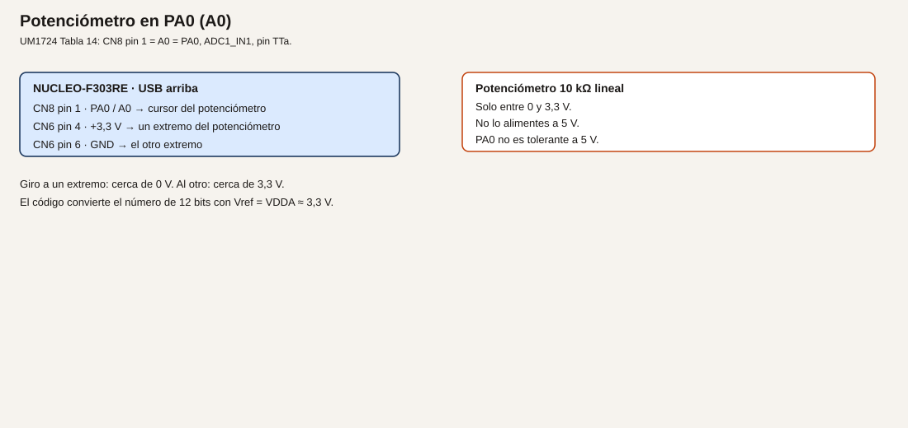
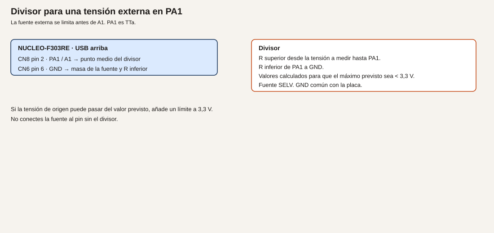
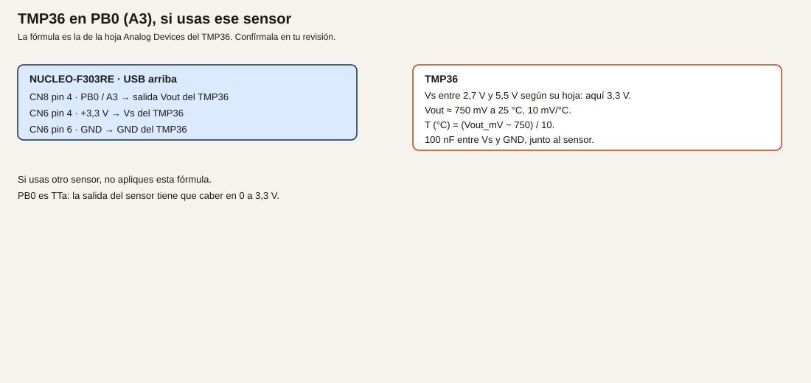

# Módulo 11. ADC

El ADC convierte una tensión en un número. En este chip es de 12 bits. En el encapsulado de 64 pines, VREF+ no sale a un pin: la nota 4 de la tabla de pines del datasheet lo une por dentro a VDDA. En la placa, VDDA llega de VDD por SB57, cerrado de fábrica. La referencia de trabajo es, por tanto, la de 3,3 V de la placa, no una referencia externa que puedas cablear en AREF esperando otro valor sin mirar el esquema.

**No comprobado en hardware.** Las conversiones de ejemplo no se midieron al redactarlas.

## Objetivos

- Leer un potenciómetro en PA0 y pasarlo a voltios.
- Atenuar una tensión de laboratorio antes de entrar en PA1.
- Leer un TMP36 en PB0, con la fórmula de su hoja, o no usar esa fórmula si el sensor es otro.

## Prerrequisitos

Módulos 2 y 7. Potenciómetro lineal de 10 kΩ. Para el ejemplo 2, una fuente SELV que no pases de 3,3 V en el pin, y dos resistencias. Para el ejemplo 3, un TMP36 o el sensor cuya hoja vayas a citar. PA0, PA1 y PB0 son TTa: de −0,3 V a VDDA + 0,3 V (datasheet, tabla 19). No son entradas de 5 V.

## Número y voltios

**Analogía.** El conversor es una regla graduada. Doce bits son 4096 marcas. La marca 0 es 0 V. La última marca está un paso por debajo de la referencia. Medir 10 V con esa regla, sin reducirlos antes, es apoyar la regla en una tensión que la rompe. La resolución no compensa el daño.

**Técnico.** PA0 es ADC1_IN1, CN8 pin 1, A0 (UM1724, tabla 14). PA1 es ADC1_IN2, A1. PB0 es ADC3_IN12, A3. Este módulo usa ADC1 para PA0 y PA1. PB0 se lee con ADC3, que es la unidad que el mapa de la placa asocia a A3. No hace falta muestrear los tres a la vez.

La relación que usarás, y que debes confirmar en el capítulo del ADC de RM0316, es:

`V = N * VDDA / 4096`

con N el valor de 12 bits, de 0 a 4095. **Convención de este curso**, alineada con ese manual, no una calibración de tu placa. VDDA se toma como 3,3 V porque SB57 la une a VDD. Si mides otra tensión en CN6 pin 4, usa esa cifra en la fórmula y anótala como tuya.

ES0261 describe, entre otras limitaciones del ADC, un overrun de DMA en modo dual intercalado con un solo canal, el comportamiento de la bandera de overrun y el muestreo en modo JAUTO. Estas tres prácticas son una conversión sencilla, por encuesta, en un solo ADC cada vez, sin inyección y sin DMA. El DMA es el módulo 15. Aun así, abre esas secciones de ES0261 antes de dar por bueno un montaje más raro que este.

El tiempo de muestreo se elige largo para un potenciómetro de 10 kΩ: la fuente es lenta y la resistencia alta. En CubeMX, un muestreo de muchas ciclos (por ejemplo 601,5 ciclos, si tu lista lo ofrece) es una elección conservadora. No está optimizado ni medido.

## Ejemplo 1. Potenciómetro en PA0

1. **Problema.** Llevar una posición a un número.
2. **Objetivo.** Imprimir por USART2 el código y la tensión mientras giras el potenciómetro.
3. **Material.** Potenciómetro de 10 kΩ lineal.
4. **Funcionamiento.** Los extremos ven 3,3 V y GND. El cursor es una fracción de 3,3 V y entra en PA0. El programa lanza una conversión, espera y transmite.
5. **Dibujo.**



6. **Cableado.**

| Origen | Destino |
| --- | --- |
| CN6 pin 4, +3,3 V | Un extremo del potenciómetro |
| CN6 pin 6, GND | El otro extremo |
| CN8 pin 1, PA0 / A0 | Cursor |

No alimentes el potenciómetro a 5 V.

7. **Cálculos.** A mitad de giro, si es lineal y está bien a los extremos, N cerca de 2048 y V cerca de 1,65 V. Extremos: cerca de 0 y cerca de 3,3 V. La corriente por el potenciómetro es 3,3 / 10000 = 0,33 mA.
8. **CubeMX.** ADC1, un solo canal IN1 (PA0), resolución 12 bits, conversión por software, muestreo largo. USART2 a 115200 8N1. No actives PA4: se reserva al DAC.
9. **Código.**

```c
/* USER CODE BEGIN 0 */
static void imprimir_pa0(void)
{
  char linea[48];
  HAL_ADC_Start(&hadc1);
  if (HAL_ADC_PollForConversion(&hadc1, 10) == HAL_OK)
  {
    uint16_t n = (uint16_t)HAL_ADC_GetValue(&hadc1);
    uint32_t mv = ((uint32_t)n * 3300U) / 4096U;
    int k = snprintf(linea, sizeof(linea), "N=%u V=%lu.%03lu\r\n",
                     n, (unsigned long)(mv / 1000U), (unsigned long)(mv % 1000U));
    if (k > 0)
    {
      HAL_UART_Transmit(&huart2, (uint8_t *)linea, (uint16_t)k, 50);
    }
  }
  HAL_ADC_Stop(&hadc1);
}
/* USER CODE END 0 */
```

```c
/* USER CODE BEGIN WHILE */
while (1)
{
  imprimir_pa0();
  HAL_Delay(200);
  /* USER CODE END WHILE */
```

`#include <stdio.h>` en los includes de usuario.

10. **Dónde.** `main.c`. `hadc1` lo genera CubeMX.
11. **Compilar y probar.** Monitor a 115200. Gira el potenciómetro de extremo a extremo.
12. **Esperado, no medido.** El número crece al acercar el cursor al extremo de 3,3 V y baja hacia el de GND. Compara un punto con el polímetro entre el cursor y GND. La diferencia es tu error de medida, no un dato de este texto.
13. **Fallos.** Siempre 0: el cursor no es PA0, o el extremo «alto» está en GND. Siempre 4095: PA0 está en 3,3 V fijo, o el canal de CubeMX no es IN1. Números que saltan con el dedo cerca: falta un 100 nF del cursor a GND si el cable es largo. Puedes añadirlo.
14. **Variación.** Imprime solo cuando N cambie más de 20 cuentas, para no llenar el monitor.
15. **Criterio.** Sabes qué pin es TTa y qué cifra de 3300 estás usando como referencia.

## Ejemplo 2. Una tensión externa, atenuada, en PA1

1. **Problema.** Leer una tensión que puede ser mayor que 3,3 V sin llevarla al pin.
2. **Objetivo.** Un divisor que deje en PA1 como máximo 2,5 V cuando la entrada prevista es 10 V, y leer ese valor.
3. **Material.** Fuente SELV. R1 = 30 kΩ desde la señal hasta PA1. R2 = 10 kΩ de PA1 a GND. 100 nF de PA1 a GND.
4. **Funcionamiento.** El divisor reduce. El ADC lee la tensión del punto medio, no la de la fuente. Si alguien aplica más de lo previsto, 12 V darían 3,0 V en el pin, todavía bajo 3,3 V. Por encima hace falta un límite (diodo a 3,3 V o similar) que esta práctica debe tener montado si la fuente puede pasarse. Las tierras se unen. Si no se pueden unir, el divisor no basta: hace falta aislamiento, y eso se discute en el módulo 27.
5. **Dibujo.**



6. **Cableado.**

| Origen | Destino |
| --- | --- |
| Señal a medir, limitada | R1 = 30 kΩ |
| R1 | CN8 pin 2, PA1 / A1, y R2 |
| R2 = 10 kΩ | CN6 pin 6, GND |
| GND de la fuente | GND de la placa |
| 100 nF | PA1 a GND |

No conectes la fuente al pin sin el divisor.

7. **Cálculos.** Vpin = Vent * 10 / (30 + 10) = Vent / 4. A 10 V, Vpin = 2,5 V. A 0 V, 0 V. A 12 V, 3,0 V. Corriente a 10 V: 10 / 40000 = 0,25 mA. N esperado a 2,5 V: 2,5 / 3,3 * 4096 ≈ 3103. **Ejemplo de diseño**, no una medida.
8. **CubeMX.** Añade ADC1 IN2 (PA1). Puedes dejar IN1 y cambiar de canal con `ADC_ChannelConfTypeDef`, o hacer este ejemplo en un proyecto que solo tenga PA1. Lo más simple: una sola conversión de PA1 en este proyecto de práctica.
9. **Código.** El mismo `imprimir_pa0`, cambiando el arranque al ADC que tenga el canal de PA1. Si sigues en `hadc1` reconfigurado a IN2, no hace falta otro handle. Imprime también la estimación de la tensión de origen: milivoltios del pin por 4.

10. **Dónde.** `main.c`.
11. **Compilar y probar.** Sube la fuente desde 0 V, sin pasar de 10 V en este ensayo. Compara el polímetro en PA1 con el texto.
12. **Esperado, no medido.** A 10 V de entrada, el pin está cerca de 2,5 V. Si tu polímetro en el pin no dice eso, para y revisa las resistencias antes de subir más.
13. **Fallos.** El pin pasa de 3,3 V: el divisor está al revés o no está. Para la fuente. Lectura a 0 con la fuente alta: GND de la fuente no es el GND de la placa, o R2 está abierta y el pin flota. No «arregles» uniendo tierras si el lado de campo no puede compartirlas.
14. **Variación.** Cambia la entrada a 5 V previstos. Vpin ≈ 1,25 V. El mismo divisor sirve, con más margen.
15. **Criterio.** Puedes calcular Vpin antes de encender la fuente, y no aplicas la fuente si el cálculo pasa de 3,0 V sin límite.

## Ejemplo 3. TMP36 en PB0

1. **Problema.** Pasar la tensión de un sensor a grados, con la hoja delante.
2. **Objetivo.** Imprimir la temperatura de un TMP36 alimentado a 3,3 V.
3. **Material.** TMP36 de Analog Devices, o no uses esta fórmula. 100 nF entre Vs y GND, junto al sensor.
4. **Funcionamiento.** La hoja del TMP36 da, en la revisión habitual, unos 750 mV a 25 °C y 10 mV/°C, con Vs de 2,7 V a 5,5 V. Aquí Vs es 3,3 V. `T = (V_mV − 750) / 10`. Confírmalo en la hoja que acompaña al componente que compres. Si el sensor es otro, para y usa su fórmula. No reutilices esta.
5. **Dibujo.**



6. **Cableado.**

| Patilla del TMP36 | Destino |
| --- | --- |
| Vs | CN6 pin 4, +3,3 V, y 100 nF a GND |
| Vout | CN8 pin 4, PB0 / A3 |
| GND | CN6 pin 6, GND |

Mira el orden de patillas en tu hoja. No lo des por el de otro transistor.

7. **Cálculos.** A 25 °C, Vout ≈ 0,75 V. N ≈ 0,75 / 3,3 * 4096 ≈ 931. A 30 °C, 800 mV. Esto es la hoja, no una estufa calibrada.
8. **CubeMX.** ADC3, canal IN12, pin PB0, 12 bits, encuesta. USART2 sigue para el texto. ADC1 puede quedarse si ya lo tenías; no conviertas PB0 con ADC1.
9. **Código.** Tras leer N en `hadc3`:

```c
uint32_t mv = ((uint32_t)n * 3300U) / 4096U;
int32_t decimas = ((int32_t)mv - 750) * 10;
```

`decimas` son décimas de grado: a 750 mV sale 0, que no es 25 °C. La fórmula en décimas es `(mv − 750)`. Imprime `(mv - 750) / 10` como grados enteros y el resto como décimas. Ejemplo de impresión: grados = `(int32_t)(mv - 750) / 10`.

10. **Dónde.** `main.c`, con `hadc3`.
11. **Compilar y probar.** A temperatura ambiente, compara con un termómetro de la sala. Calienta el sensor con el dedo: el número debe subir. No lo calientes con un soldador.
12. **Esperado, no medido.** Cerca de la temperatura de la sala, con el error de la hoja y de tu referencia de 3,3 V. Anota la tuya.
13. **Fallos.** Números negativos grandes: Vs y GND cambiados, o la fórmula aplicada a otro sensor. Siempre 0: Vout no es PB0. Más de 3,3 V en el pin: el sensor está alimentado a una tensión cuya salida no cabe, o no es un TMP36.
14. **Variación.** Si no tienes TMP36, deja este ejemplo sin montar y escribe en el informe qué sensor usarías y qué fórmula cita su hoja. No inventes el factor.
15. **Criterio.** La fórmula está copiada de la hoja que tienes en la mesa, o el ejemplo está sin montar a propósito.

## Resumen

12 bits, referencia VDDA. PA0 es el potenciómetro a 3,3 V. PA1 entra por un divisor. PB0 solo lleva un sensor cuya salida quepa en 0 a 3,3 V.

## Glosario

| Término | Definición |
| --- | --- |
| ADC | Conversor de tensión a número |
| LSB | El escalón de esa regla. Aquí, VDDA/4096 |
| TTa | Pin analógico que no admite más de VDDA + 0,3 V |
| Muestreo | El tiempo que el conversor conecta el pin antes de medir |

## Preguntas

**1.** ¿4095 cuentas son exactamente 3,3 V?

Respuesta. Con la fórmula de este módulo, 4095 * 3,3 / 4096 queda un escalón por debajo de 3,3 V. Confírmalo en RM0316.

**2.** ¿Puedo ganar resolución alimentando el potenciómetro a 5 V?

Respuesta. No. PA0 es TTa. La resolución no autoriza esa tensión.

**3.** ¿El TMP36 y un LM35 comparten fórmula?

Respuesta. No. Si cambias de sensor, cambias la fórmula. La de este módulo es la del TMP36.

## Lista de comprobación

- [ ] El potenciómetro va de 3,3 V a GND, no a 5 V.
- [ ] He calculado la tensión del pin antes de aplicar la fuente del divisor.
- [ ] La fórmula de temperatura es la de la hoja que compré, o no he montado el sensor.

## Siguiente

[Módulo 12](13-modulo-12-dac.md): generar una tensión en PA4.
