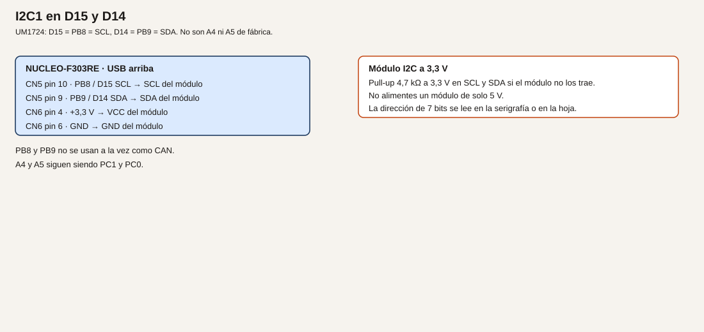

# Módulo 13. I2C

I2C lleva varios dispositivos en dos hilos: reloj y datos. Cada uno responde a una dirección. En esta placa el bus del curso es I2C1 en PB8 (SCL) y PB9 (SDA), que son D15 y D14. No son A4 ni A5. De fábrica A4 es PC1 y A5 es PC0 (UM1724, tabla 10, SB56 y SB51 cerrados; SB46 y SB52 abiertos).

**No comprobado en hardware.** Las direcciones hay que leerlas en el módulo que compres.

## Objetivos

- Recorrer las direcciones de 7 bits y ver quién responde.
- Leer la temperatura de un MCP9808 a 3,3 V.
- Escribir en una pantalla OLED SSD1306 a 3,3 V, si el módulo es de ese controlador.

## Prerrequisitos

Módulo 7 para el texto por USART2. Cables, 4,7 kΩ si el módulo no trae pull-up, alimentación a 3,3 V. Un módulo pensado solo para 5 V no se conecta directo.

PB8 y PB9 también pueden ser CAN. Este curso no los usa para CAN. El CAN va por PA11 y PA12.

## El bus

**Analogía.** Es un pasillo con varios armarios. El reloj es el ritmo al que se habla. La dirección es el número del armario. El ACK es el «aquí estoy» del armario. Las resistencias de pull-up son el muelle que deja los dos hilos en reposo a 3,3 V: los dispositivos solo tiran a masa, no empujan a alto.

**Técnico.** HAL usa la dirección desplazada un bit a la izquierda: la de 7 bits 0x18 se pasa como `0x18 << 1`. Velocidad de este módulo: 100 kHz, estándar, suficiente para un sensor y una pantalla pequeña. Pull-up externo de 4,7 kΩ a 3,3 V en SCL y en SDA si el módulo no los trae. El pull interno de 25 kΩ a 55 kΩ (datasheet, tabla 66) es demasiado alto para un bus con cable. No lo uses como único pull-up.

ES0261 menciona casos del I2C en direccionamiento de 10 bits. Estas prácticas son de 7 bits. Aun así, no actives el modo de 10 bits.

## Ejemplo 1. Barrido de direcciones

1. **Problema.** Antes de culpar al programa, saber si hay alguien en el bus.
2. **Objetivo.** Imprimir por USART2 cada dirección de 7 bits que responda.
3. **Material.** El módulo I2C ya cableado, aunque todavía no sepas su dirección. Puede ser el sensor, la pantalla o los dos.
4. **Funcionamiento.** De la dirección 1 a la 127 se llama a `HAL_I2C_IsDeviceReady`. Un ACK es un dispositivo. La dirección 0 no se usa.
5. **Dibujo.**



6. **Cableado.**

| Nucleo | Módulo |
| --- | --- |
| CN5 pin 10, PB8 / D15, SCL | SCL |
| CN5 pin 9, PB9 / D14, SDA | SDA |
| CN6 pin 4, +3,3 V | VCC |
| CN6 pin 6, GND | GND |
| 4,7 kΩ a 3,3 V | En SCL y en SDA, si el módulo no los trae |

7. **Cálculos.** No hay conversión todavía. 100 kHz es la velocidad del reloj del bus.
8. **CubeMX.** I2C1, PB8 SCL, PB9 SDA, 100 kHz. USART2 115200 8N1. No asignes I2C a PB6/PB7: esos pines serán el encoder.
9. **Código.**

```c
/* USER CODE BEGIN 2 */
for (uint8_t dir = 1; dir < 128U; dir++)
{
  if (HAL_I2C_IsDeviceReady(&hi2c1, (uint16_t)(dir << 1), 1U, 10U) == HAL_OK)
  {
    char linea[24];
    int n = snprintf(linea, sizeof(linea), "ack 0x%02X\r\n", dir);
    if (n > 0)
    {
      HAL_UART_Transmit(&huart2, (uint8_t *)linea, (uint16_t)n, 20);
    }
  }
}
/* USER CODE END 2 */
```

10. **Dónde.** `USER CODE BEGIN 2` en `main.c`.
11. **Compilar y probar.** Graba, abre el monitor, pulsa reset para repetir el barrido.
12. **Esperado, no medido.** Una línea por cada dispositivo. Un MCP9808 con A0–A2 a GND responde en 0x18. Una OLED SSD1306 suele responder en 0x3C, a veces en 0x3D. La serigrafía manda, no este párrafo.
13. **Fallos.** Ningún ACK: SDA y SCL cambiados, falta un pull-up, el módulo está a 5 V y no responde, o no hay GND. Todos los ACK: SDA está fija a masa. Direcciones que no coinciden con la serigrafía: estás leyendo el byte ya desplazado. El programa imprime la de 7 bits.
14. **Variación.** Quita el módulo y confirma que el barrido queda en silencio. Así sabes que las respuestas eran suyas.
15. **Criterio.** La lista de direcciones coincide con lo que hay enchufado.

## Ejemplo 2. Temperatura con el MCP9808

1. **Problema.** Leer un sensor ya digital, sin ADC.
2. **Objetivo.** Imprimir grados a partir del registro de temperatura ambiente.
3. **Material.** MCP9808 alimentado a 3,3 V. Hoja Microchip a mano.
4. **Funcionamiento.** La dirección de 7 bits con los pines de dirección a GND es 0x18. El registro de temperatura ambiente es 0x05. Son 16 bits. En la revisión habitual de la hoja, el bit 12 es el signo y los bits 11 a 0 son la temperatura en pasos de 0,0625 °C. Si el signo es 0, `T = (valor & 0x0FFF) / 16`. Si es 1, `T = 256 − (valor & 0x0FFF) / 16`. Confírmalo en tu revisión. Si no tienes este sensor, no adaptes la fórmula a otro: usa el barrido del ejemplo 1 y deja este ejemplo sin montar.
5. **Dibujo.** El mismo cableado I2C. Un solo módulo, o compartido con la pantalla si las direcciones no coinciden.
6. **Cableado.** El del ejemplo 1. A0, A1 y A2 del MCP9808 a GND para obtener 0x18, como diga la hoja.
7. **Cálculos.** 25 °C serían 25 * 16 = 400 cuentas en los 12 bits, signo 0. No es una medida de este texto.
8. **CubeMX.** El I2C1 del ejemplo 1.
9. **Código.**

```c
/* USER CODE BEGIN 0 */
static int leer_mcp9808(int32_t *centigrados)
{
  uint8_t reg = 0x05U;
  uint8_t dato[2];
  if (HAL_I2C_Mem_Read(&hi2c1, (uint16_t)(0x18U << 1), reg,
                       I2C_MEMADD_SIZE_8BIT, dato, 2U, 50U) != HAL_OK)
  {
    return -1;
  }
  uint16_t valor = (uint16_t)((dato[0] << 8) | dato[1]);
  uint16_t mag = (uint16_t)(valor & 0x0FFFU);
  if ((valor & 0x1000U) != 0U)
  {
    *centigrados = 256 - (int32_t)(mag / 16U);
  }
  else
  {
    *centigrados = (int32_t)(mag / 16U);
  }
  return 0;
}
/* USER CODE END 0 */
```

En el bucle, llama a la función e imprime `centigrados` por USART2 cada medio segundo.

10. **Dónde.** `main.c`.
11. **Compilar y probar.** Compara con la temperatura de la sala y con el dedo, sin soldador.
12. **Esperado, no medido.** Un valor cercano a la sala si la hoja y la dirección son las de tu pieza. Si `Mem_Read` falla, el barrido del ejemplo 1 dice si la dirección es otra.
13. **Fallos.** Siempre error: dirección distinta por A0–A2, o registro distinto en tu revisión. Valor absurdo: el orden de los dos bytes está al revés. Comprueba que el primer byte recibido es el alto, como hace la hoja.
14. **Variación.** Imprime también las décimas: el resto `mag % 16` vale 0,0625 °C cada una.
15. **Criterio.** La dirección y la fórmula salen de la hoja, y el bus sigue a 3,3 V.

## Ejemplo 3. OLED SSD1306

1. **Problema.** Ver un texto sin depender del PC.
2. **Objetivo.** Encender un panel de 128×64 con controlador SSD1306 y escribir una página de píxeles.
3. **Material.** Módulo OLED I2C de 3,3 V. Si el tuyo es de 128×32, el comando de multiplex no es el mismo: usa el de tu hoja y no este listado a ciegas.
4. **Funcionamiento.** Se envían comandos de inicio y después bytes de imagen. La dirección habitual es 0x3C. El byte de control 0x00 precede a un comando y 0x40 a datos de imagen, en el modo que describe la hoja del SSD1306. Confírmalo.
5. **Dibujo.** El mismo bus. Dirección distinta de la del sensor.
6. **Cableado.** El del ejemplo 1. Pull-up si el módulo no los trae. VCC a 3,3 V.
7. **Cálculos.** No hay una corriente de LED que calcular en el GPIO: la pantalla se alimenta del pin de 3,3 V de la placa. Si el módulo pide más de lo que te queda de presupuesto, no lo alimentes de un GPIO.
8. **CubeMX.** El mismo I2C1.
9. **Código.** Secuencia mínima para un 128×64, tomada del procedimiento habitual del controlador. Comprueba cada comando en tu hoja antes de darla por buena.

```c
/* USER CODE BEGIN 0 */
static void oled_cmd(uint8_t cmd)
{
  uint8_t trama[2] = {0x00U, cmd};
  HAL_I2C_Master_Transmit(&hi2c1, (uint16_t)(0x3CU << 1), trama, 2U, 50U);
}

static void oled_inicio(void)
{
  const uint8_t seq[] = {
    0xAE, 0xD5, 0x80, 0xA8, 0x3F, 0xD3, 0x00, 0x40,
    0x8D, 0x14, 0x20, 0x00, 0xA1, 0xC8, 0xDA, 0x12,
    0x81, 0xCF, 0xD9, 0xF1, 0xDB, 0x40, 0xA4, 0xA6, 0xAF
  };
  for (uint32_t i = 0; i < sizeof(seq); i++)
  {
    oled_cmd(seq[i]);
  }
}
/* USER CODE END 0 */
```

Después de `oled_inicio`, pon el cursor en columna 0 y página 0 con los comandos 0x21, 0x00, 0x7F, 0x22, 0x00, 0x07, y envía 128 bytes `0xFF` con el control 0x40. Verás una franja encendida. Un tipo de letra completo es un ejercicio: no hace falta una fuente entera para aceptar el ejemplo.

10. **Dónde.** `main.c`, llamada a `oled_inicio` en `USER CODE BEGIN 2`.
11. **Compilar y probar.** Graba. Debe encenderse el panel y verse la franja.
12. **Esperado, no medido.** El panel deja de estar en negro y muestra esa franja. Si la dirección es 0x3D, cámbiala. No hay una foto en el repositorio.
13. **Fallos.** El barrido no ve 0x3C: alimentación, pull-up o dirección. El barrido lo ve y la pantalla sigue negra: secuencia de un tamaño distinto (128×32 usa otro multiplex), o el módulo no es SSD1306. No insistas con más tensión.
14. **Variación.** Manda 128 bytes a 0x00 y la franja se apaga. Así compruebas que los datos, no solo el encendido, llegan.
15. **Criterio.** Sensor y pantalla, si están los dos, conviven porque las direcciones son distintas, y ninguno está a 5 V.

## Resumen

PB8 y PB9, 100 kHz, pull-up a 3,3 V. El barrido va antes que la hoja del sensor. La fórmula del MCP9808 no se reutiliza para otro componente. La OLED se inicia con la secuencia de su tamaño.

## Glosario

| Término | Definición |
| --- | --- |
| SCL | Reloj del bus |
| SDA | Datos del bus |
| ACK | Respuesta de un dispositivo a su dirección |
| Dirección de 7 bits | El número del dispositivo, antes de desplazarla para el HAL |

## Preguntas

**1.** ¿Por qué I2C no va en A4 y A5?

Respuesta. En esta placa, de fábrica, A4 y A5 son PC1 y PC0. El I2C fijo del Arduino es D15 y D14.

**2.** ¿Sirve el pull interno solo?

Respuesta. No para este bus. Está entre 25 kΩ y 55 kΩ. Se ponen 4,7 kΩ si el módulo no los trae.

**3.** ¿PB8 puede ser CAN a la vez?

Respuesta. No en este curso. El CAN está en PA11 y PA12.

## Lista de comprobación

- [ ] El barrido lista las direcciones que realmente he conectado.
- [ ] El sensor está a 3,3 V y la fórmula es la de su hoja.
- [ ] La pantalla, si la hay, no comparte dirección con el sensor.

## Siguiente

[Módulo 14](15-modulo-14-spi.md): un reloj, un dato de ida, un dato de vuelta y un hilo de selección por dispositivo.
