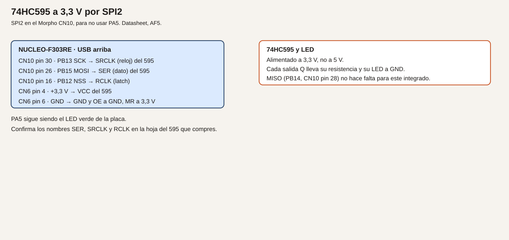

# Módulo 14. SPI

SPI lleva reloj, dato de ida, dato de vuelta y una selección por cada dispositivo. El maestro es la Nucleo. Este curso usa SPI2 para no ocupar PA5, que es el LED y también sería SPI1_SCK.

**No comprobado en hardware.**

## Objetivos

- Encender LED a través de un 74HC595 alimentado a 3,3 V.
- Leer el registro WHO_AM_I de un LIS3DH, si ese es el sensor que tienes.
- Hablar con los dos sin que se pisen, cada uno con su NSS.

## Prerrequisitos

Módulo 13 no es obligatorio, pero el hábito de comprobar el cable antes que el programa sí. Un 74HC595. Para el ejemplo 2, un LIS3DH o un módulo equivalente a 3,3 V. Resistencias para los LED del 595, calculadas como en el módulo 5.

## Pines

**Verificado** en el datasheet, tabla 14 de funciones alternativas, AF5, y en UM1724 tabla 26:

| Señal | Pin del LQFP64 | Morpho |
| --- | --- | --- |
| PB13, SPI2_SCK | — | CN10 pin 30 |
| PB15, SPI2_MOSI | — | CN10 pin 26 |
| PB14, SPI2_MISO | — | CN10 pin 28 |
| PB12, SPI2_NSS | — | CN10 pin 16 |

El segundo NSS no es PB6. PB6 queda para el encoder del módulo 16, como TIM4_CH1. El segundo selector es PA6, D12, CN5 pin 5, como GPIO.

**Analogía.** El reloj es el ritmo. MOSI es lo que el maestro dice. MISO es lo que el esclavo contesta en el mismo ritmo. NSS es la mano en el hombro: solo habla el dispositivo al que has tocado. Si tocas a los dos, los dos contestan a la vez y el bus no sirve.

ES0261 describe fallos del CRC del SPI y del bit BSY en ciertos modos. Estas prácticas son maestro, sin CRC. No actives el CRC. Aun así, localiza esas secciones en la errata antes de copiar un ejemplo de otro curso que sí lo use.

## Ejemplo 1. 74HC595 y una fila de LED

1. **Problema.** Ocho LED y pocos pines.
2. **Objetivo.** Sacar un byte por el 595 y ver el patrón en los LED.
3. **Material.** 74HC595 a 3,3 V. Ocho LED, cada uno con su resistencia a GND, o los que quieras poblar. Hoja del 595 para confirmar los nombres SER, SRCLK y RCLK.
4. **Funcionamiento.** SPI manda el byte por MOSI al ritmo de SCK. Un pulso en el latch (aquí PB12 como GPIO, no como NSS hardware) copia el registro de desplazamiento a las salidas. El 595 no devuelve datos útiles para este ejemplo: MISO puede quedar sin cable.
5. **Dibujo.**



6. **Cableado.**

| Nucleo | 74HC595, nombres habituales |
| --- | --- |
| CN10 pin 30, PB13, SCK | SRCLK o SHCP, reloj |
| CN10 pin 26, PB15, MOSI | SER o DS, dato |
| CN10 pin 16, PB12 | RCLK o STCP, latch |
| CN6 pin 4, +3,3 V | VCC |
| CN6 pin 6, GND | GND, y OE a GND |
| +3,3 V | MR, reset de maestro, para no dejarlo en reset |

Confirma los nombres en tu hoja. Cada Q lleva su resistencia y su LED al cátodo en GND. No alimentes el 595 a 5 V: sus salidas irían a 5 V y, si alguna volviera a un pin TTa, no sería válida. Aunque las salidas solo vayan a LED, este curso lo alimenta a 3,3 V.

7. **Cálculos.** Cada LED, con el ejemplo de 270 Ω y 4,8 mA, sale del 595, no del STM32. La suma la aguanta el 595 según su hoja, no según la tabla 17 del STM32. El pin PB12 solo da un pulso de latch, despreciable frente a 8 mA.
8. **CubeMX.** SPI2 solo maestro, PB13 SCK, PB15 MOSI, PB14 MISO aunque no se cablee. Prescaler para quedar muy por debajo de lo que pida el 595; a 72 MHz, un prescaler de 64 deja cerca de 1 MHz. Modo 0: CPOL bajo, CPHA primer flanco, que es el habitual del 595. Confírmalo. PB12 como `GPIO_Output`, nivel alto en reposo. NSS hardware desactivado: el latch lo haces tú.
9. **Código.**

```c
/* USER CODE BEGIN 0 */
static void sacar_595(uint8_t patron)
{
  HAL_GPIO_WritePin(GPIOB, GPIO_PIN_12, GPIO_PIN_RESET);
  HAL_SPI_Transmit(&hspi2, &patron, 1U, 20);
  HAL_GPIO_WritePin(GPIOB, GPIO_PIN_12, GPIO_PIN_SET);
}
/* USER CODE END 0 */
```

En el bucle, llama con `0x01`, espera, `0x80`, espera, `0xFF`, espera. `HAL_Delay` aquí solo deja ver el patrón.

10. **Dónde.** `main.c`.
11. **Compilar y probar.** Graba. Los LED deben cambiar de patrón.
12. **Esperado, no medido.** `0x01` enciende un extremo y `0x80` el otro. Si están al revés, el bit de menos peso no es el Q que creías. No es un fallo del SPI si el patrón cambia.
13. **Fallos.** Todos apagados: OE no está a GND, o MR está a GND y el registro vive en reset. Nada cambia: SCK y MOSI cambiados, o el latch no da el pulso. LED muy brillantes y calientes: falta la resistencia. No los dejes así.
14. **Variación.** Desplaza un único 1 por el byte en cada vuelta: `patron = (patron << 1) | (patron >> 7)`.
15. **Criterio.** El patrón que escribes es el que ves, y el 595 está a 3,3 V.

## Ejemplo 2. WHO_AM_I de un LIS3DH

1. **Problema.** Comprobar un sensor SPI leyendo un registro que la hoja fija.
2. **Objetivo.** Leer el registro 0x0F y obtener 0x33, que es el valor que la hoja del LIS3DH asigna a WHO_AM_I. Confírmalo en tu revisión. Si el sensor es otro, usa su registro y su valor, no el 0x33.
3. **Material.** LIS3DH a 3,3 V, con SDO cableado a MISO.
4. **Funcionamiento.** Para leer, el LIS3DH pide el bit de lectura en la dirección del registro. En la hoja de ST, ese bit es el bit 7. Se envían dos bytes: `0x0F | 0x80` y un byte de relleno. El segundo byte que vuelve por MISO es el identificador. El modo SPI que indica la revisión habitual es CPOL = 1 y CPHA = 1. Confírmalo. CS del sensor es activo a bajo.
5. **Dibujo.** Añade el sensor al bus del ejemplo 1. Su CS no es PB12.
6. **Cableado.** SCK, MOSI y MISO compartidos con el 595. CS del LIS3DH a PA6, CN5 pin 5, D12. VCC 3,3 V. GND común. El 595 puede seguir en PB12.
7. **Cálculos.** No hay una conversión física: el resultado esperado del registro es 0x33 o no lo es.
8. **CubeMX.** SPI2 en el modo que pida el LIS3DH. Si ese modo no coincide con el del 595, no los dejes en el mismo proyecto a la vez: haz este ejemplo con el 595 desconectado, o cambia el modo solo mientras hablas con el sensor y documéntalo. PA6 `GPIO_Output`, reposo a 1.
9. **Código.**

```c
/* USER CODE BEGIN 0 */
static uint8_t lis3dh_whoami(void)
{
  uint8_t tx[2] = { (uint8_t)(0x0FU | 0x80U), 0x00U };
  uint8_t rx[2] = {0U, 0U};
  HAL_GPIO_WritePin(GPIOA, GPIO_PIN_6, GPIO_PIN_RESET);
  HAL_SPI_TransmitReceive(&hspi2, tx, rx, 2U, 20);
  HAL_GPIO_WritePin(GPIOA, GPIO_PIN_6, GPIO_PIN_SET);
  return rx[1];
}
/* USER CODE END 0 */
```

Imprime el byte por USART2.

10. **Dónde.** `main.c`. Mantén PB12 a 1 para que el 595 no escuche, si sigue conectado y el modo SPI coincide.
11. **Compilar y probar.** Graba y mira el monitor.
12. **Esperado, no medido.** `0x33` si el dispositivo es un LIS3DH y el modo es el de su hoja. Otro valor estable puede ser otro sensor: no lo fuerces.
13. **Fallos.** 0x00 o 0xFF: MISO sin cable, CS que no baja, o modo SPI distinto. El 595 cambia de patrón mientras lees: su latch está bajando. Déjalo a 1.
14. **Variación.** Lee dos veces seguidas. El valor tiene que repetirse.
15. **Criterio.** El número que imprimes es el de la hoja, o has anotado que el sensor no es un LIS3DH.

## Ejemplo 3. Dos NSS

1. **Problema.** Dos dispositivos en los mismos SCK, MOSI y MISO.
2. **Objetivo.** Escribir el 595 y leer el LIS3DH en el mismo bucle, cada uno con su selector en alto mientras habla el otro.
3. **Material.** Los dos, si el modo SPI puede ser el mismo. Si no puede, el segundo dispositivo de este ejemplo puede ser otro 595 con su latch en PA6, y el criterio pasa a ser «cada chip muestra un patrón distinto».
4. **Funcionamiento.** Antes de hablar, el selector del otro está a 1. Se baja solo el del destinatario. Al terminar, se sube.
5. **Dibujo.** El del 595, más PA6 al segundo CS.
6. **Cableado.** PB12 solo al primer latch o CS. PA6 solo al segundo. MISO únicamente al dispositivo que tenga que responder.
7. **Cálculos.** No hay.
8. **CubeMX.** PB12 y PA6 como GPIO de salida, ambos a 1 en reposo.
9. **Código.** En el bucle: `sacar_595(0x0F)` con PA6 a 1, y después `lis3dh_whoami()` con PB12 a 1. Esas dos funciones ya suben y bajan su propio selector si las escribiste así. No llames a `HAL_SPI_Transmit` con los dos selectores a 0.
10. **Dónde.** El bucle de `main.c`.
11. **Compilar y probar.** El patrón del 595 no debe cambiar cuando lees el sensor, y el identificador no debe cambiar cuando escribes el 595.
12. **Esperado, no medido.** Las dos operaciones se alternan sin pisarse.
13. **Fallos.** El identificador se corrompe al escribir el 595: los dos CS bajan juntos, o el modo SPI no vale para los dos y hay que separarlos en proyectos. Documenta cuál de las dos cosas era.
14. **Variación.** Intercambia los patrones `0x0F` y `0xF0` cada segundo y confirma que el WHO_AM_I sigue igual.
15. **Criterio.** Puedes señalar qué hilo es de quién, y PB6 no está usado como selector.

## Resumen

SPI2 en el Morpho. El 595 a 3,3 V enseña el byte. El segundo selector es PA6, no PB6. Sin CRC.

## Glosario

| Término | Definición |
| --- | --- |
| SCK | Reloj que genera el maestro |
| MOSI | Dato del maestro al esclavo |
| MISO | Dato del esclavo al maestro |
| NSS | Selección de un esclavo, activa a bajo en estos dispositivos |

## Preguntas

**1.** ¿Por qué no se usa SPI1?

Respuesta. Porque SPI1_SCK es PA5, y PA5 es LD2.

**2.** ¿El 595 a 5 V es un problema si solo enciende LED?

Respuesta. Este curso lo alimenta a 3,3 V para no tener salidas de 5 V junto a pines que no las admiten.

**3.** ¿PB6 puede ser el segundo NSS?

Respuesta. No en el mapa de este curso. PB6 es el canal A del encoder.

## Lista de comprobación

- [ ] Cada LED del 595 tiene su resistencia.
- [ ] He confirmado el modo SPI en la hoja del dispositivo que lee.
- [ ] Los dos selectores no están bajos a la vez.
- [ ] No he activado el CRC.

## Siguiente

[Módulo 15](16-modulo-15-dma.md): llenar una tabla de medidas sin copiar cada muestra a mano.
