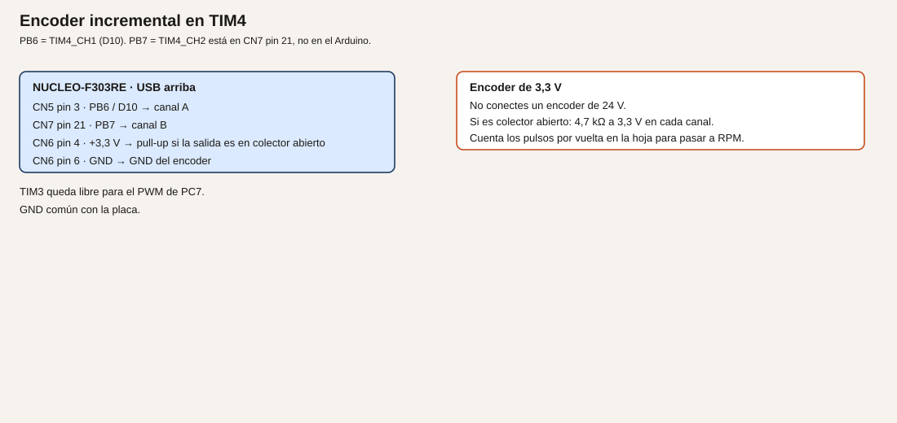

# Módulo 16. Encoder, pulsos y velocidad

Contar pulsos es contar piezas o marcas. Pasar a RPM exige saber cuántos pulsos trae una vuelta y durante cuánto tiempo has contado. El encoder de verdad tiene dos canales en cuadratura, para saber también el sentido.

**No comprobado en hardware.** El número de pulsos por vuelta sale de la hoja del encoder que compres, no de este texto.

## Objetivos

- Contar pulsos de un contacto a 3,3 V.
- Calcular RPM con un número conocido de marcas.
- Leer un encoder incremental en TIM4, canales PB6 y PB7.

## Prerrequisitos

Módulos 8 y 9. Para el ejemplo 3, un encoder o un módulo de cuadratura de 3,3 V. No se conecta un encoder industrial de 24 V.

## Pines que este módulo fija

La ficha dejaba el pin para cuando la lección se escribiera. Queda así:

| Canal | Señal | Conector | Función |
| --- | --- | --- | --- |
| A | PB6 | CN5 pin 3, D10 | TIM4_CH1 |
| B | PB7 | CN7 pin 21 | TIM4_CH2 |

El datasheet, tabla 13, lista TIM4_CH1 en PB6 y TIM4_CH2 en PB7. TIM3 no se usa: el PWM del LED sigue en TIM3 canal 2, PC7. PB6 no es el selector SPI. PB8 y PB9 siguen siendo I2C. PA2 y PA3 siguen siendo el puerto virtual.

PB6 y PB7 son FTf. La salida del encoder tiene que ser de 3,3 V, o colector abierto con pull-up a 3,3 V. Tolerar 5 V en la entrada no autoriza un encoder de 24 V.

**Analogía.** Un pulso es una muesca que pasa delante de un sensor. Contar muescas no dice la velocidad hasta que divides por el tiempo. Dos sensores desfasados, como dos finales de carrera un poco corridos, dicen si la rueda va adelante o atrás según cuál se active primero.

## Ejemplo 1. Contar pulsos

1. **Problema.** Ver la cuenta antes de hablar de velocidad.
2. **Objetivo.** Incrementar un contador en cada flanco aceptado y mostrarlo.
3. **Material.** B1, o un generador de 3,3 V. No un generador de 5 V sobre un pin TTa. B1 está en PC13, que es TC: el generador, si lo usas, va a un pin preparado. Para no abrir otro pin, este ejemplo cuenta B1.
4. **Funcionamiento.** La interrupción del módulo 9, con filtro de 20 ms, incrementa `pulsos`. El bucle imprime el valor cuando cambia.
5. **Dibujo.** No hay cable si usas B1.
6. **Cableado.** PC13 interno. USART2 al PC.

| Señal | Papel |
| --- | --- |
| PC13 | Flanco a contar |
| PA2/PA3 | Texto |

7. **Cálculos.** No hay RPM todavía. Cada clic aceptado es +1.
8. **CubeMX.** El EXTI de PC13 del módulo 9 y USART2.
9. **Código.** El `aviso_b1` del módulo 9. En el bucle:

```c
if (aviso_b1)
{
  aviso_b1 = 0U;
  pulsos++;
}
```

Imprime `pulsos` por USART2 cuando el valor cambie.

10. **Dónde.** `main.c`.
11. **Compilar y probar.** Diez pulsaciones deliberadas, separadas.
12. **Esperado, no medido.** El número termina en 10. Si termina en más, el filtro no está.
13. **Fallos.** Los del módulo 9. Cuenta al soltar y al pulsar: has habilitado los dos flancos. Deja solo la bajada.
14. **Variación.** Resetea la cuenta con la letra `z` recibida por USART2.
15. **Criterio.** La cuenta coincide con los clics que has dado.

## Ejemplo 2. RPM con marcas conocidas

1. **Problema.** La cuenta crece siempre. La velocidad es pulsos por tiempo.
2. **Objetivo.** Calcular RPM en una ventana de un segundo, con N marcas por vuelta escritas en el programa.
3. **Material.** El contador del ejemplo 1. Una rueda de prueba de la que conozcas las marcas, o el propio dedo si fijas N = 1 y aceptas que es un ensayo, no un eje.
4. **Funcionamiento.** Cada 1000 ms se mira cuántos pulsos nuevos hubo. `vueltas = pulsos / marcas_por_vuelta`. `RPM = vueltas * 60 / 1 s`. En una ventana de un segundo, `RPM = pulsos * 60 / marcas_por_vuelta`.
5. **Dibujo.** No hay uno nuevo si sigues en B1.
6. **Cableado.** El del ejemplo 1.
7. **Cálculos.** Ejemplo: 1 marca por vuelta y 2 pulsos en un segundo → 120 RPM. Con 20 marcas por vuelta y 20 pulsos en un segundo → 60 RPM. La división entera trunca. Si quieres décimas, calcula `pulsos * 600 / marcas` y separa la parte entera. El número de marcas es el de tu hoja o el que pintaste en la rueda. No se inventa aquí un encoder concreto.
8. **CubeMX.** Sin pines nuevos.
9. **Código.**

```c
/* USER CODE BEGIN PV */
static volatile uint32_t pulsos;
static const uint32_t marcas_por_vuelta = 1U;
/* USER CODE END PV */
```

```c
/* USER CODE BEGIN WHILE */
while (1)
{
  static uint32_t marca = 0U;
  static uint32_t pulsos_antes;
  if ((HAL_GetTick() - marca) >= 1000U)
  {
    uint32_t ahora = pulsos;
    uint32_t delta = ahora - pulsos_antes;
    pulsos_antes = ahora;
    marca = HAL_GetTick();
    if (marcas_por_vuelta != 0U)
    {
      uint32_t rpm = (delta * 60U) / marcas_por_vuelta;
      char linea[40];
      int n = snprintf(linea, sizeof(linea), "rpm %lu\r\n", (unsigned long)rpm);
      if (n > 0)
      {
        HAL_UART_Transmit(&huart2, (uint8_t *)linea, (uint16_t)n, 20);
      }
    }
  }
  /* USER CODE END WHILE */
```

`pulsos` lo incrementa la interrupción. Tiene que ser `volatile`.

10. **Dónde.** `main.c`.
11. **Compilar y probar.** Con N = 1, pulsa dos veces dentro de un segundo y lee la línea.
12. **Esperado, no medido.** Cerca de 120 si los dos pulsos cayeron en esa ventana. Si cayeron entre dos ventanas, se reparten. Es el método, no un error de la fórmula.
13. **Fallos.** Siempre 0: la interrupción no incrementa, o `marcas_por_vuelta` se quedó en 0 y el `if` no divide. Números enormes: N está a 1 y el rebote cuenta decenas. Vuelve al filtro.
14. **Variación.** Cambia la ventana a 500 ms. La fórmula pasa a `RPM = delta * 120 / marcas_por_vuelta`, porque 60 / 0,5 = 120. Escribe la unidad al lado.
15. **Criterio.** Puedes rehacer la cuenta a mano con los pulsos que imprime el programa.

## Ejemplo 3. Cuadratura en TIM4

1. **Problema.** Un solo canal no dice el sentido, y contar por interrupción cada flanco de un encoder rápido carga al núcleo.
2. **Objetivo.** Dejar que TIM4 cuente en modo encoder y leer el contador.
3. **Material.** Encoder de 3,3 V, o dos salidas en cuadratura. Si son colector abierto, 4,7 kΩ a 3,3 V en cada canal. No un encoder de 24 V.
4. **Funcionamiento.** En modo encoder TI12, el timer cuenta y descuenta según el desfase de los dos canales. El programa lee el contador en la ventana de un segundo y aplica la misma fórmula. Las marcas por vuelta son las que la hoja llama pulsos por revolución en ese modo, o cuatro veces las cuentas del disco si el timer cuenta todos los flancos. Lee esa frase en la hoja y en el capítulo de timers de RM0316 antes de fiarte del número. Anota cuál usaste.
5. **Dibujo.**



6. **Cableado.**

| Encoder | Nucleo |
| --- | --- |
| Canal A | CN5 pin 3, PB6 / D10 |
| Canal B | CN7 pin 21, PB7 |
| VCC, si el encoder lo necesita a 3,3 V | CN6 pin 4 |
| GND | CN6 pin 6 |
| Pull-up 4,7 kΩ | De 3,3 V a A y de 3,3 V a B, solo si la salida es abierta |

7. **Cálculos.** Los de la fórmula del ejemplo 2, con el N de la hoja. No hay un N universal.
8. **CubeMX.** TIM4 en modo encoder, CH1 en PB6, CH2 en PB7. Filtro de entrada del timer en un valor bajo para un encoder lento de prácticas; si el datasheet del encoder trae ruido, sube el filtro y anótalo. No reasignes TIM3.
9. **Código.**

```c
/* USER CODE BEGIN 2 */
HAL_TIM_Encoder_Start(&htim4, TIM_CHANNEL_ALL);
/* USER CODE END 2 */
```

Cada segundo:

```c
uint16_t cuenta = (uint16_t)__HAL_TIM_GET_COUNTER(&htim4);
```

Guarda la cuenta anterior y usa la diferencia con signo de 16 bits si quieres ver el sentido: un incremento es un sentido y un decremento el otro. Pasa el valor absoluto a la fórmula de RPM e imprime también el signo.

10. **Dónde.** `main.c`.
11. **Compilar y probar.** Gira despacio en los dos sentidos. Mira si el contador sube y baja.
12. **Esperado, no medido.** El sentido cambia con el giro. La RPM es coherente con tu N y con lo rápido que giras, a ojo. No hay un tacómetro de referencia en este texto.
13. **Fallos.** Solo cuenta en un sentido: un canal no está cableado o no tiene pull-up. No cuenta: los pines no son PB6 y PB7, o el encoder está a 24 V y no debiste conectarlo. Si ya lo conectaste, quítalo y revisa si el pin sigue respondiendo como GPIO antes de seguir. Cuenta al revés: cambia A y B, o invierte el signo en el programa y dilo.
14. **Variación.** Vuelve al ejemplo 2 con un solo canal si el encoder se estropea, y deja escrito que has perdido el sentido.
15. **Criterio.** Sabes de qué hoja sale N, y TIM3 sigue libre para el PWM.

## Resumen

La cuenta es un número. La RPM divide por el tiempo y por las marcas. TIM4 en PB6 y PB7 lee la cuadratura. Nada de 24 V.

## Glosario

| Término | Definición |
| --- | --- |
| Pulso | Un flanco que decides contar |
| RPM | Vueltas por minuto |
| Cuadratura | Dos señales desfasadas que indican el sentido |
| Marcas por vuelta | El dato de la hoja, sin el cual la fórmula no tiene unidad |

## Preguntas

**1.** ¿Diez pulsos son diez RPM?

Respuesta. No. Falta el tiempo y faltan las marcas de una vuelta.

**2.** ¿Por qué el encoder no usa TIM3?

Respuesta. Porque TIM3 canal 2 es el PWM de PC7. TIM4 está libre para esto.

**3.** ¿Un pin FT justifica un encoder de 24 V?

Respuesta. No. FT admite hasta 5,5 V como máximo absoluto en la entrada. 24 V no entran en esa frase.

## Lista de comprobación

- [ ] He contado pulsos antes de calcular RPM.
- [ ] La fórmula tiene unidades y el N está escrito.
- [ ] El encoder, si lo hay, es de 3,3 V, con pull-up solo si hace falta.
- [ ] PB6 no está usado como NSS del SPI.

## Siguiente

[Módulo 17](18-modulo-17-estados.md): ponerle nombre a cada situación del programa.
