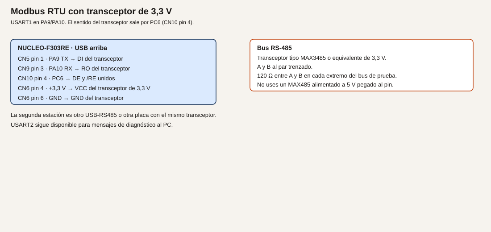

# Módulo 21. Modbus RTU

Modbus RTU publica registros a un maestro por un par de hilos diferenciales. La placa no trae ese par: hace falta un transceptor RS-485 de 3,3 V. USART2 se queda para los mensajes al PC. El enlace de campo es USART1.

**No comprobado en hardware.** El CRC de abajo es el algoritmo publicado del Modbus, no una trama capturada en esta redacción.

## Objetivos

- Construir una trama a mano y comprobar su CRC.
- Responder a una lectura de un registro de retención.
- Aceptar una escritura solo si el valor cabe en el rango.

## Prerrequisitos

Módulo 7. Desconecta el ESP32 de PA9 y PA10: esos pines pasan a ser el UART del transceptor. Un transceptor de 3,3 V, por ejemplo un MAX3485 o equivalente. No un MAX485 alimentado a 5 V con las patillas lógicas pegadas al STM32. Par trenzado. Resistencia de 120 Ω en cada extremo del bus de prueba. Un maestro: un adaptador USB-RS485 o una segunda placa con el mismo transceptor.

## Pines

| Señal | Conector | Destino en el transceptor |
| --- | --- | --- |
| PA9, USART1_TX | CN5 pin 1, D8 | DI |
| PA10, USART1_RX | CN9 pin 3, D2 | RO |
| PC6 | CN10 pin 4 | DE y /RE unidos |
| +3,3 V | CN6 pin 4 | VCC del transceptor |
| GND | CN6 pin 6 | GND |

PC6 es FT (datasheet, tabla 13). La salida sigue a 3,3 V, que es lo que un transceptor de 3,3 V espera. A y B van al par. La hoja del transceptor dice cuál es A y cuál es B. Si el maestro no ve nada, invertir A y B es la primera prueba, no subir la tensión.

**Analogía.** El maestro pregunta por un número de cajón. El esclavo contesta con el contenido, o se niega si el número no existe o el valor no cabe. DE es el pulsador de «ahora hablo yo» del transceptor. Si se queda pulsado, nadie más puede hablar. El CRC es la suma de comprobación del sobre: si no cuadra, se tira el sobre.

## Ejemplo 1. La trama, todavía por UART

1. **Problema.** Separar un error de CRC de un error de cable.
2. **Objetivo.** Construir la petición «leer un registro de retención» y comprobar los dos bytes de CRC.
3. **Material.** Solo el programa. Puedes imprimir la trama por USART2 en hexadecimal. Todavía no hace falta el transceptor.
4. **Funcionamiento.** Función 0x03, esclavo 0x01, registro 0x0000, cantidad 0x0001. El CRC-16 del Modbus usa el polinomio 0xA001, valor inicial 0xFFFF, y en la trama va el byte bajo primero.
5. **Dibujo.** No hay.
6. **Cableado.** No hay todavía.
7. **Cálculos.** La trama sin CRC es `01 03 00 00 00 01`. El CRC que tiene que salirte con el algoritmo de abajo se imprime en el ensayo. No se da aquí un valor memorizado de otra web: calcúlalo con esta función y, si tienes una hoja de ejemplo oficial de Modbus, compáralo. Si no coincide con un ejemplo impreso de la especificación, el algoritmo está mal copiado y no sigas al bus.
8. **CubeMX.** USART2 para el informe. USART1 puede esperar al ejemplo 2.
9. **Código.**

```c
/* USER CODE BEGIN 0 */
static uint16_t modbus_crc(const uint8_t *buf, uint16_t len)
{
  uint16_t crc = 0xFFFFU;
  for (uint16_t i = 0; i < len; i++)
  {
    crc ^= buf[i];
    for (uint8_t b = 0; b < 8U; b++)
    {
      if ((crc & 1U) != 0U)
      {
        crc = (uint16_t)((crc >> 1) ^ 0xA001U);
      }
      else
      {
        crc = (uint16_t)(crc >> 1);
      }
    }
  }
  return crc;
}
/* USER CODE END 0 */
```

Imprime los bytes `01 03 00 00 00 01` y después `crc & 0xFF` y `crc >> 8`.

10. **Dónde.** `main.c`.
11. **Compilar y probar.** Mira el monitor. Anota los dos bytes.
12. **Esperado, no medido.** Los mismos dos bytes cada vez que arrancas. Si los comparas con un ejemplo de la especificación Modbus y no coinciden, corrige la función antes del ejemplo 2.
13. **Fallos.** Un byte distinto en cada arranque: estás metiendo basura no inicializada en el buffer. CRC que no coincide con la especificación: el polinomio o el orden de los bytes está mal. No lo «arregles» en el maestro desactivando el CRC.
14. **Variación.** Cambia la cantidad de registros a 2 y observa que el CRC cambia.
15. **Criterio.** Puedes rehacer el CRC a mano para un buffer de un byte y seguir el bucle, aunque sea tedioso, en el primer bit.

## Ejemplo 2. Esclavo que responde a una lectura

1. **Problema.** Un maestro quiere leer un registro.
2. **Objetivo.** El esclavo 1 responde a la función 0x03, registro 0, con un valor fijo de prueba, 0x1234.
3. **Material.** El transceptor y el maestro. 120 Ω entre A y B en los dos extremos de este bus corto. En un banco de dos metros, dos resistencias. No pongas una tercera en medio.
4. **Funcionamiento.** Se recibe por USART1 hasta un silencio. Con 115200 bit/s, un silencio de unos 2 ms se da por fin de trama en esta práctica (más que 3,5 caracteres). Es una simplificación de diseño, no un analizador con marca de tiempo certificada. Se comprueba el CRC. Si la función es 0x03, la dirección es 1 y el registro es 0, se contesta. Para contestar, PC6 se pone a 1, se transmite, se espera a que el UART termine (`HAL_UART_Transmit` bloqueante en esta práctica) y PC6 vuelve a 0.
5. **Dibujo.**



6. **Cableado.** La tabla de pines de arriba. A con A y B con B entre esclavo y maestro, salvo que la hoja nombre los bornes al revés: entonces pruébalo y déjalo escrito. GND del transceptor con GND de la placa. El maestro USB-RS485 tiene su propia alimentación. No unas 5 V del adaptador a un pin del STM32.
7. **Cálculos.** Valor 0x1234. La respuesta, antes del CRC, es `01 03 02 12 34`. Longitud del dato: 2 bytes. El CRC se añade con la misma función.
8. **CubeMX.** USART1 115200 8N1 en PA9 y PA10. Puedes bajar a 9600 si tu adaptador viene así: la velocidad tiene que coincidir en los dos extremos. PC6 salida, reposo a 0 (recepción).
9. **Código.** Un buffer de 64 bytes. En el bucle, lee con timeout corto y rearma un silencio con `HAL_GetTick`. Cuando el silencio cierre la trama, comprueba que haya al menos 4 bytes y que el CRC de todos menos los dos últimos coincida. Si cuadra y es la lectura esperada:

```c
uint8_t resp[7] = {0x01, 0x03, 0x02, 0x12, 0x34, 0x00, 0x00};
uint16_t c = modbus_crc(resp, 5);
resp[5] = (uint8_t)(c & 0xFFU);
resp[6] = (uint8_t)(c >> 8);
HAL_GPIO_WritePin(GPIOC, GPIO_PIN_6, GPIO_PIN_SET);
HAL_UART_Transmit(&huart1, resp, 7, 20);
HAL_GPIO_WritePin(GPIOC, GPIO_PIN_6, GPIO_PIN_RESET);
```

Imprime por USART2 `lectura ok` para saber que entró, sin mezclar esos bytes en USART1.

10. **Dónde.** `main.c`.
11. **Compilar y probar.** Desde el maestro, lee el holding register 0 del esclavo 1. En muchos programas el registro se numera desde 40001 o desde 0: usa la numeración que tu maestro documente, que para la función 0x03 y dirección 0 es el primero.
12. **Esperado, no medido.** El maestro muestra 0x1234. USART2 dice que la trama entró. Si el maestro no muestra nada, mira A/B y DE antes de tocar el CRC, que ya comprobaste.
13. **Fallos.** El maestro ve basura: DE se quedó a 1, o las velocidades no coinciden. No hay respuesta: PC6 no sube, o /RE no está unido a DE y el receptor del transceptor sigue deshabilitado según la hoja. CRC malo en el maestro: el orden de los bytes del CRC está al revés.
14. **Variación.** Cambia el valor fijo a 0x0007 y comprueba que el maestro lo ve sin cambiar el CRC a mano: lo recalcula el programa.
15. **Criterio.** El registro leído es el que el programa metió en la respuesta.

## Ejemplo 3. Escribir un registro, con rango

1. **Problema.** El maestro también quiere dejar una consigna.
2. **Objetivo.** La función 0x06 escribe el registro 1. Si el valor es mayor que 1000, se responde con una excepción y no se guarda.
3. **Material.** El mismo bus.
4. **Funcionamiento.** La petición 0x06 trae el valor en dos bytes. Si es mayor que 1000, la respuesta de excepción es dirección, `0x06 | 0x80`, código 0x03 (valor ilegal, en la convención habitual de Modbus), más CRC. Si cabe, se guarda en RAM y se hace eco de la petición, que es lo que la función 0x06 espera. El registro 0 sigue siendo la lectura de prueba; puedes hacer que la lectura del registro 1 devuelva lo guardado. Amplía el `if` del ejemplo 2.
5. **Dibujo.** El mismo.
6. **Cableado.** El mismo.
7. **Cálculos.** Rango permitido: 0 a 1000 inclusive. 1001 se rechaza. El límite es de esta práctica, no de la especificación.
8. **CubeMX.** Sin pines nuevos.
9. **Código.** Una variable `static uint16_t consigna;`. En el tratamiento de la trama, si función 0x06, registro 1:

```c
uint16_t valor = (uint16_t)((buf[4] << 8) | buf[5]);
if (valor > 1000U)
{
  uint8_t ex[5] = {0x01, 0x86, 0x03, 0x00, 0x00};
  uint16_t c = modbus_crc(ex, 3);
  ex[3] = (uint8_t)(c & 0xFFU);
  ex[4] = (uint8_t)(c >> 8);
  /* transmitir ex con DE, igual que la respuesta buena */
}
else
{
  consigna = valor;
  /* eco de los 8 bytes recibidos, que ya traen su CRC */
}
```

La lectura 0x03 del registro 1 debe devolver `consigna`.

10. **Dónde.** El mismo parser del bucle.
11. **Compilar y probar.** Escribe 100. Lee el registro 1. Escribe 1001. La lectura debe seguir en 100 y el maestro debe indicar excepción.
12. **Esperado, no medido.** 100 se guarda. 1001 no. Si quitas la alimentación, se pierde: la Flash es el módulo 24.
13. **Fallos.** 1001 se guarda: el `if` está al revés. La excepción no llega: DE no envuelve esa respuesta corta. El maestro no entiende la excepción: el código no es 0x03 o falta el bit 0x80 de la función.
14. **Variación.** Rechaza también el registro distinto de 0 y de 1, con código de excepción 0x02 (dirección ilegal).
15. **Criterio.** Puedes enseñar una escritura aceptada y una rechazada, y USART2 no se ha usado como bus de campo.

## Resumen

CRC con 0xA001. Transceptor de 3,3 V. DE en PC6, en bajo mientras se escucha. El rango se rechaza con excepción. El ESP32 no puede seguir conectado a PA9 y PA10.

## Glosario

| Término | Definición |
| --- | --- |
| RTU | Modbus en binario, con CRC, sobre un enlace serie |
| Registro de retención | Un entero de 16 bits que el maestro puede leer o escribir |
| DE | Habilitación del driver del transceptor |
| Excepción | Respuesta que niega la petición, con la función marcada |

## Preguntas

**1.** ¿Por qué no un MAX485 a 5 V?

Respuesta. Porque sus entradas y salidas lógicas irían a 5 V. Aunque PA9 y PA10 toleren 5 V en la entrada, este curso no alimenta el transceptor a 5 V pegado al pin. Se usa uno de 3,3 V.

**2.** ¿USART2 puede ser el Modbus?

Respuesta. No en este curso. USART2 es el informe al PC por el ST-LINK.

**3.** ¿Una sola resistencia de 120 Ω en un extremo basta en esta mesa?

Respuesta. En un cable corto a veces hay enlace, y aun así la práctica pone 120 Ω en los dos extremos para no aprender un bus a medias.

## Lista de comprobación

- [ ] El CRC del ejemplo 1 es repetible y, si lo comparé con la especificación, coincide.
- [ ] El transceptor es de 3,3 V y el ESP32 está desconectado.
- [ ] DE vuelve a 0 después de cada respuesta.
- [ ] El valor 1001 no se queda guardado.

## Siguiente

[Módulo 22](23-modulo-22-can.md): dos nodos, un identificador, sin maestro único.
