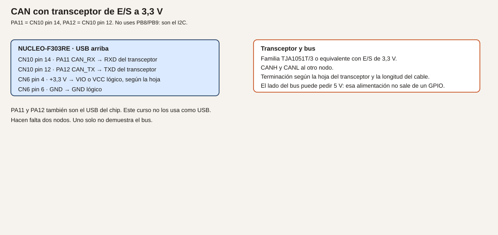

# Módulo 22. CAN

El STM32F303RET6 tiene un controlador CAN 2.0B. En el HAL de esta familia el tipo es `CAN_HandleTypeDef`, no el FDCAN de otras series. La placa no tiene transceptor ni conector. Hacen falta dos nodos: uno solo no demuestra el bus.

**No comprobado en hardware.** El bit timing de abajo es una cuenta con el reloj de 36 MHz de APB1. Confírmalo en tu pestaña de reloj. No se ha medido con un analizador.

## Objetivos

- Transmitir un identificador y recibirlo en otro nodo.
- Filtrar un identificador y descartar otro.
- Repetir el intercambio con un adaptador o con una segunda Nucleo.

## Prerrequisitos

Dos transceptores con E/S de 3,3 V, de la familia TJA1051T/3 o equivalente. La alimentación del lado del bus, si la hoja pide 5 V, sale de una fuente de 5 V, no de un GPIO. Cable entre CANH y CANL. La terminación se copia de la hoja del transceptor y de la longitud del cable. No se da aquí una cifra distinta de la de esa hoja. En muchos módulos didácticos la resistencia ya está montada y se activa con un puente: usa ese puente una vez por extremo, no además una resistencia suelta si el módulo ya la tiene.

## Pines

PA11 es CAN_RX, CN10 pin 14. PA12 es CAN_TX, CN10 pin 12. El datasheet los lista como funciones alternativas, y también como USB_DM y USB_DP. Este curso no los usa como USB. No se usan PB8 y PB9: son el I2C.

| Nucleo | Transceptor |
| --- | --- |
| PA11, CN10 pin 14 | RXD |
| PA12, CN10 pin 12 | TXD |
| CN6 pin 4, +3,3 V | VIO o el pin de alimentación lógica que la hoja diga |
| CN6 pin 6, GND | GND lógico |
| CANH, CANL | Al otro nodo |
| 5 V, si la hoja los pide en VCC del bus | Fuente aparte, no un GPIO |

**Analogía.** A diferencia de Modbus, no hay un maestro que pregunte por turnos. Cada nodo suelta un mensaje con un identificador, como un aviso por megafonía con un número. Quien tenga ese número en su filtro lo escucha. Los demás lo dejan pasar. Los dos hilos son un par: no es un UART con TX y RX cruzados.

## Bit timing

Con PCLK1 = 36 MHz y 500 kbit/s: el tiempo de bit se parte en cuantos. Prescaler 8, segmento de sincronización 1 tq, BS1 = 6 tq, BS2 = 2 tq, SJW = 1 tq. Suma 1 + 6 + 2 = 9 tq. `36e6 / (8 * 9) = 500000 bit/s`. En el HAL:

```c
hcan.Init.Prescaler = 8;
hcan.Init.SyncJumpWidth = CAN_SJW_1TQ;
hcan.Init.TimeSeg1 = CAN_BS1_6TQ;
hcan.Init.TimeSeg2 = CAN_BS2_2TQ;
```

El punto de muestreo queda al final de BS1. Si tu reloj no es 36 MHz en APB1, no uses estos números: recalcula y escribe la cuenta al lado. Modo normal, no loopback, cuando haya dos nodos. El loopback sirve para ver que el controlador acepta un mensaje, y se dice que no prueba el transceptor.

## Ejemplo 1. Un identificador de un nodo a otro

1. **Problema.** Ver un mensaje en el otro extremo.
2. **Objetivo.** El nodo A envía el identificador estándar 0x123 con un byte 0x42. El nodo B lo imprime por su USART2.
3. **Material.** Dos placas, o una placa y un adaptador que pueda quedar en silencio y solo recibir. Para este ejemplo, receptor en la segunda Nucleo.
4. **Funcionamiento.** Cada placa inicializa el CAN, arranca el periférico y, en A, llama a `HAL_CAN_AddTxMessage` una vez por segundo. En B, `HAL_CAN_GetRxMessage` si hay un mensaje en el FIFO.
5. **Dibujo.**



6. **Cableado.** El de la tabla, repetido en los dos nodos. CANH con CANH, CANL con CANL. GND lógico común si los transceptores lo necesitan para la referencia de las E/S; el par diferencial no sustituye un error de alimentación. Sigue la hoja.
7. **Cálculos.** 500 kbit/s con la cuenta de arriba. DLC = 1. Identificador 0x123.
8. **CubeMX.** CAN en PA11 y PA12, 500 kbit/s con esos segmentos, modo normal. Habilita la interrupción de FIFO0 o haz encuesta del FIFO. USART2 para el texto en el nodo B.
9. **Código.** En el transmisor, después de `HAL_CAN_Start` y de configurar un filtro que deje pasar (en el ejemplo 2 se afina):

```c
CAN_TxHeaderTypeDef tx = {0};
uint8_t dato = 0x42U;
uint32_t buzon;
tx.StdId = 0x123U;
tx.IDE = CAN_ID_STD;
tx.RTR = CAN_RTR_DATA;
tx.DLC = 1;
HAL_CAN_AddTxMessage(&hcan, &tx, &dato, &buzon);
```

En el receptor:

```c
CAN_RxHeaderTypeDef rx = {0};
uint8_t dato = 0U;
if (HAL_CAN_GetRxFifoFillLevel(&hcan, CAN_RX_FIFO0) > 0U)
{
  HAL_CAN_GetRxMessage(&hcan, CAN_RX_FIFO0, &rx, &dato);
}
```

Imprime `rx.StdId` y `dato` por USART2.

10. **Dónde.** `main.c` de cada nodo. Son dos proyectos, o el mismo con un `#if` que no vas a dejar a medias: mejor dos carpetas, `nodo_a` y `nodo_b`, si las creas. Esta lección no exige el árbol de carpetas; sí exige que sepas cuál placa transmite.
11. **Compilar y probar.** Alimenta los dos transceptores. Graba las dos placas. Mira el monitor del receptor.
12. **Esperado, no medido.** Aparece el identificador 0x123 y el byte 0x42 cada segundo. El LED de error del transceptor, si el módulo lo tiene, no debe quedarse en fallo de bus. Si se queda, la terminación o los hilos están mal, y el controlador verá errores. Puedes leer el contador de errores que el HAL exponga y imprimirlo.
13. **Fallos.** Loopback activado en los dos: cada uno se oye a sí mismo y el cable no se ha probado. Quítalo. Nada en el receptor: CANH y CANL cambiados, terminación duplicada o ausente según la hoja, o el filtro por defecto descarta. Velocidad distinta en los dos nodos. Un solo nodo encendido: el transmisor acumula errores porque nadie da el ACK del bus. Eso es normal en CAN. Hace falta el segundo nodo.
14. **Variación.** Cambia el byte a un contador. El receptor debe verlo crecer.
15. **Criterio.** El mensaje cruzó el cable. No vale el modo loopback como prueba final.

## Ejemplo 2. Un filtro

1. **Problema.** El nodo no tiene por qué leer todos los identificadores.
2. **Objetivo.** Aceptar 0x123 y no aceptar 0x321.
3. **Material.** Los dos nodos. El transmisor envía los dos identificadores, alternados.
4. **Funcionamiento.** Un filtro de máscara en 32 bits, identificador estándar. La máscara a unos en los bits del identificador exige coincidencia. Se configura antes de `HAL_CAN_Start`, como pide el HAL.
5. **Dibujo.** El mismo.
6. **Cableado.** El mismo.
7. **Cálculos.** Id 0x123, máscara 0x7FF para un estándar de 11 bits: solo pasa ese. El HAL desplaza el identificador estándar; usa los campos `FilterIdHigh` y `FilterMaskIdHigh` como indique el comentario del propio HAL de tu versión, que suele colocar el ID estándar en los bits altos. Mira `CAN_FilterTypeDef` en la cabecera generada y copia el desplazamiento que use un ejemplo de esa misma versión del paquete, no el de un chip FDCAN. Anota los valores que dejes.
8. **CubeMX.** El filtro puede ir en código. Modo de filtro: máscara, FIFO0, filtro activado.
9. **Código.** Esquema, a completar con el desplazamiento de tu HAL:

```c
CAN_FilterTypeDef filtro = {0};
filtro.FilterBank = 0;
filtro.FilterMode = CAN_FILTERMODE_IDMASK;
filtro.FilterScale = CAN_FILTERSCALE_32BIT;
filtro.FilterFIFOAssignment = CAN_RX_FIFO0;
filtro.FilterActivation = ENABLE;
/* FilterIdHigh y FilterMaskIdHigh: según la cabecera de esta versión */
HAL_CAN_ConfigFilter(&hcan, &filtro);
```

El transmisor alterna `StdId` 0x123 y 0x321.

10. **Dónde.** Inicialización del receptor.
11. **Compilar y probar.** Mira qué identificadores imprime el receptor.
12. **Esperado, no medido.** Solo 0x123. Si pasan los dos, la máscara está a cero, que es «pasa todo».
13. **Fallos.** No pasa ninguno: el desplazamiento del ID dentro de `FilterIdHigh` no es el de tu HAL. Compara con la estructura generada. Pasan todos: máscara nula.
14. **Variación.** Abre la máscara un bit y observa qué identificador vecino empezaría a pasar. Vuelve a dejarla estricta.
15. **Criterio.** En el monitor del receptor no aparece 0x321.

## Ejemplo 3. Una segunda estación distinta

1. **Problema.** Dos programas gemelos no demuestran que el mensaje sea entendible fuera de tu código.
2. **Objetivo.** Sustituir el nodo B por un adaptador CAN-USB, o dejar el adaptador como tercer observador, y ver 0x123.
3. **Material.** El adaptador, con su velocidad a 500 kbit/s y el mismo bit timing si el programa lo pide. Si el adaptador solo pide la velocidad, pon 500 kbit/s.
4. **Funcionamiento.** El nodo A sigue transmitiendo. El programa del fabricante del adaptador muestra el identificador. No hace falta un driver propio en esta lección.
5. **Dibujo.** El mismo par, ahora hasta el adaptador. Terminación en los dos extremos reales del cable, no en los tres sitios si hay tres conectores en el medio: los extremos físicos del bus.
6. **Cableado.** CANH, CANL y la referencia que pida el adaptador. Muchos adaptadores no deben recibir 5 V desde la Nucleo. Lee su hoja.
7. **Cálculos.** La misma velocidad. Si el adaptador no ve nada y las dos Nucleo sí se veían, el adaptador está a otra velocidad o el pinout del conector DB9 no es el que creías. El DB9 de CAN no está normalizado en una sola frase universal: mira la serigrafía del adaptador.
8. **CubeMX.** El del nodo A.
9. **Código.** El transmisor del ejemplo 1, sin cambio si ya alternaba identificadores. Deja solo 0x123 para no confundir el primer pantallazo.
10. **Dónde.** Proyecto del nodo A.
11. **Compilar y probar.** Abre el programa del adaptador. Debes ver 0x123 y el byte.
12. **Esperado, no medido.** El identificador y el dato coinciden con el código. El nodo B puede estar apagado si el adaptador da el ACK. Si ni el adaptador ni otra placa escuchan, el transmisor entrará en error por falta de ACK.
13. **Fallos.** El adaptador alimentado desde el pin de 5 V de la placa y la placa se cae: usa el USB del adaptador. Identificador desplazado 3 bits: estás mirando el campo crudo del registro. Quédate con el `StdId` que muestra el programa del adaptador y compáralo con 0x123.
14. **Variación.** Envía desde el adaptador un 0x123 y recíbelo en la Nucleo con el filtro del ejemplo 2. Así los dos sentidos quedan vistos.
15. **Criterio.** Un programa que no compilaste tú muestra el mismo identificador que escribes en `StdId`.

## Resumen

PA11 y PA12, transceptor de E/S a 3,3 V, 500 kbit/s con la cuenta del reloj de 36 MHz, dos nodos, filtro de máscara. USB del chip no se usa. PB8 y PB9 no se tocan.

## Glosario

| Término | Definición |
| --- | --- |
| Identificador | El número del mensaje, no una dirección de esclavo al estilo Modbus |
| Transceptor | El chip que pasa de TXD/RXD al par CANH/CANL |
| ACK | El bit con el que otro nodo dice que oyó el mensaje |
| Filtro | La regla que decide qué mensaje entra en el FIFO |

## Preguntas

**1.** ¿Por qué un solo nodo no basta?

Respuesta. Porque en CAN alguien tiene que reconocer el mensaje. Sin segundo nodo, el transmisor acumula error.

**2.** ¿PB8 sirve como CAN_RX en este curso?

Respuesta. El chip lo permite. El curso no: PB8 es el reloj I2C.

**3.** ¿Estos pines pueden ser el USB de dispositivo a la vez?

Respuesta. No. Son los mismos pines. Este curso los deja en CAN.

## Lista de comprobación

- [ ] He anotado el reloj de APB1 con el que calculé el bit timing.
- [ ] Hay dos nodos, o un nodo y un adaptador, en los extremos del par.
- [ ] El filtro deja pasar 0x123 y no 0x321.
- [ ] No he cableado CAN en PB8/PB9 ni USB en PA11/PA12.

## Siguiente

[Módulo 23](24-modulo-23-watchdog.md): volver a arrancar si el programa se queda colgado.
