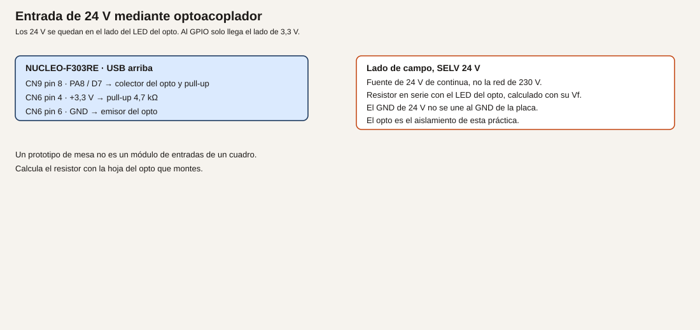
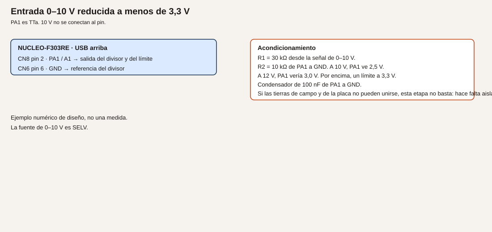
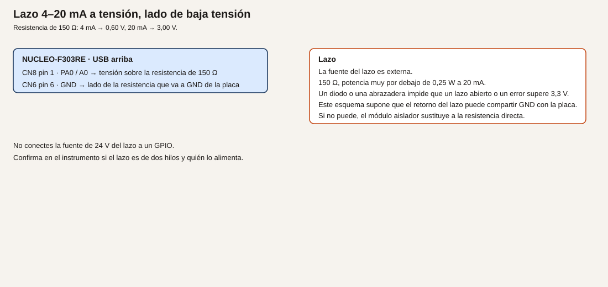

# Módulo 27. Interfaces para señales industriales

La placa no tiene entradas de 24 V, ni de 0–10 V, ni de 4–20 mA. Este módulo dibuja la cadena: señal de campo, protección, aislamiento si las tierras no se pueden unir, y solo entonces un pin de 3,3 V. Lo que se monta en la mesa sigue siendo baja tensión en el lado de la Nucleo. El lado de 24 V, si se monta, queda del otro lado del aislamiento y con una fuente SELV. No se usa la red de 230 V.

**No comprobado en hardware.** Los números son de diseño. No son un ensayo de aislamiento ni un equipo de cuadro.

## Objetivos

- Entrar un 24 V de continua a través de un optoacoplador, y leer un GPIO.
- Reducir 0–10 V con un divisor que deje el pin por debajo de 3,3 V, y decir cuándo eso no basta.
- Convertir 4–20 mA en una tensión que quepa en el ADC, si el retorno puede compartir GND.

## Prerrequisitos

Módulos 2, 5 y 11. Para el ejemplo 1, un optoacoplador (el que tengas, con su hoja) y una fuente de 24 V de continua SELV. Para el ejemplo 2, resistencias de 30 kΩ y 10 kΩ. Para el ejemplo 3, 150 Ω de potencia adecuada y una fuente de lazo, o un módulo ya aislado cuya hoja cites. PA8 en el ejemplo 1 no puede llevar a la vez el LED rojo del semáforo ni el pulsador del módulo 5. PA1 es el 0–10 V. PA0 es el 4–20 mA. No los uses a la vez para el potenciómetro.

## Qué no es

Un módulo de entradas de cuadro, un equipo con marcado, un ensayo de aislamiento o un bornero de potencia. Es un prototipo de mesa para entender la cadena.

**Analogía.** El pin del microcontrolador es un instrumento de panel. La señal de campo es la línea de fuerza o de proceso. No se empalman porque «las dos son cables». El optoacoplador es una ventana: pasa el aviso de luz y no pasa el cobre. El divisor es una reducción, y solo vale si las dos referencias de masa son la misma. Si no lo son, reducir no aísla.

## Ejemplo 1. 24 V con optoacoplador

1. **Problema.** Saber que un contacto de 24 V está cerrado, sin llevar 24 V a PA8.
2. **Objetivo.** PA8 a nivel bajo cuando el lado de campo enciende el LED del opto.
3. **Material.** Optoacoplador con su hoja. Fuente SELV de 24 V. Resistencia serie del LED calculada con el Vf y la If de esa hoja. En el lado de la placa, 4,7 kΩ de 3,3 V al colector, y el emisor a GND de la placa.
4. **Funcionamiento.** El contacto o la fuente encienden el LED interno a través de su resistencia. El fototransistor acerca PA8 a GND. En reposo, el pull-up deja PA8 a 3,3 V. El GND de 24 V no se une al GND de la placa.
5. **Dibujo.**

6. **Cableado.**

| Lado | Conexión |
| --- | --- |
| Campo | Fuente 24 V SELV, resistencia calculada, LED del opto. GND de 24 V solo en ese lado |
| Placa | Colector a CN9 pin 8, PA8 / D7, y a 4,7 kΩ hacia CN6 pin 4 |
| Placa | Emisor del opto a CN6 pin 6, GND |
| Prohibido | Unir los dos GND «para que funcione mejor» en esta práctica |

7. **Cálculos.** Ejemplo de plantilla, no un opto concreto: If deseada 5 mA, Vf el de tu hoja. `R = (24 − Vf) / 0,005`. Si Vf = 1,2 V, R = 4560 Ω, comercial 4,7 kΩ, e If queda un poco por debajo de 5 mA. Usa tu Vf. Potencia en la resistencia: cerca de 24 V * 5 mA = 0,12 W. Una resistencia de 1/4 W sirve en este ejemplo si la cuenta de tu If no la supera. El lado del GPIO no ve 24 V.
8. **CubeMX.** PA8 entrada. Sin pull interno si el externo de 4,7 kΩ está montado.
9. **Código.** El mismo esquema que B1: nivel bajo significa activo. Imprime `campo 1` o `campo 0` por USART2 cuando cambie, con el antirrebote del módulo 5 si el contacto es mecánico.
10. **Dónde.** `main.c`.
11. **Compilar y probar.** Con la fuente de 24 V apagada, PA8 debe leer 1. Enciende el lado de campo. PA8 debe leer 0. Mide que en el conector de la Nucleo no hay 24 V: mide PA8 respecto al GND de la placa antes de darlo por bueno.
12. **Esperado, no medido.** El texto cambia con la fuente de campo. El polímetro en PA8 no pasa de 3,3 V. Si pasa, para y revisa el opto: no continúes.
13. **Fallos.** PA8 siempre a 1: el LED del opto no enciende, la resistencia está mal calculada, o el transistor está en el pin que no es. PA8 siempre a 0: colector y emisor cambiados, o un puente entre los dos lados. Has unido los GND: esta práctica deja de ser el ejemplo de aislamiento. Deshaz esa unión.
14. **Variación.** Invierte el sentido en el programa si quieres un 1 lógico cuando el campo está activo. El cable no cambia.
15. **Criterio.** Has medido PA8 por debajo de 3,3 V con el campo encendido y apagado, y los GND no están unidos.

## Ejemplo 2. 0–10 V con divisor

1. **Problema.** Leer una señal de 0–10 V en un pin que no admite 10 V.
2. **Objetivo.** A 10 V de entrada, PA1 cerca de 2,5 V. A 12 V, cerca de 3,0 V. Por encima, un límite que impida pasar de 3,3 V.
3. **Material.** R1 = 30 kΩ desde la señal hasta PA1. R2 = 10 kΩ de PA1 a GND. 100 nF de PA1 a GND. Una forma de limitar: diodo Schottky del pin hacia 3,3 V, o no subir la fuente de ensayo por encima de 12 V. Fuente SELV.
4. **Funcionamiento.** El divisor reduce. El ADC del módulo 11 lee PA1. Esto supone GND común. Si la masa de campo no puede unirse a la de la placa, el divisor no aísla: hace falta un módulo aislador, y este ejemplo no lo sustituye.
5. **Dibujo.**

6. **Cableado.**

| Punto | Destino |
| --- | --- |
| Señal 0–10 V | R1 = 30 kΩ |
| R1 y R2 | CN8 pin 2, PA1 / A1 |
| R2 | GND de la placa |
| GND de la fuente | GND de la placa, solo si ese común está permitido |
| 100 nF | PA1 a GND |

7. **Cálculos.** `Vpin = Vent * 10 / 40`. A 10 V, 2,5 V. A 0 V, 0 V. A 12 V, 3,0 V. N a 2,5 V, con la fórmula del módulo 11: `2,5 / 3,3 * 4096 ≈ 3103`. Corriente a 10 V: 0,25 mA. **Ejemplo de diseño.**
8. **CubeMX.** ADC en PA1, como en el módulo 11.
9. **Código.** Imprime milivoltios del pin y la estimación `mv * 4`, que es la tensión de origen si el divisor es exactamente 30 kΩ y 10 kΩ. Las tolerancias de las resistencias son el error de esa estimación. No lo llames exactitud de instrumento.
10. **Dónde.** `main.c`.
11. **Compilar y probar.** Sube de 0 a 10 V. Mide el pin con el polímetro en cada paso antes de fiarte del número del UART.
12. **Esperado, no medido.** A 10 V de fuente, el pin cerca de 2,5 V. Si no es así, para.
13. **Fallos.** Pin por encima de 3,3 V: divisor al revés. Lectura 0: no hay GND común y lo necesitabas, o R2 abierta. Alguien te pide aislar y tú solo tienes el divisor: no sirve. Cambia de montaje.
14. **Variación.** Entra 5 V. Vpin cerca de 1,25 V. La misma cadena.
15. **Criterio.** El cálculo está hecho antes de aplicar la fuente, y has dicho por escrito si las tierras podían unirse.

## Ejemplo 3. 4–20 mA

1. **Problema.** Un lazo de corriente no se conecta a un pin como si fuera una tensión.
2. **Objetivo.** Convertir 4–20 mA en 0,60–3,00 V sobre 150 Ω, y leerlo en PA0, solo si el retorno del lazo puede compartir el GND de la placa.
3. **Material.** Resistencia de 150 Ω. El lazo, alimentado por su fuente, no por un GPIO. Un límite que impida que un fallo supere 3,3 V en el pin: un diodo a 3,3 V, o un módulo aislador si el retorno no puede compartir masa. Si usas un módulo comercial, manda su hoja y no este divisor.
4. **Funcionamiento.** La corriente del lazo atraviesa los 150 Ω. La tensión es `I * 150`. PA0 la lee. A 4 mA, 0,60 V. A 20 mA, 3,00 V. Potencia a 20 mA: `0,02^2 * 150 = 0,06 W`. Cabe en 1/4 W. A 30 mA por error serían 4,5 V y 0,135 W: por eso hace falta el límite, no porque 20 mA exactos ya quemen la resistencia.
5. **Dibujo.**

6. **Cableado.**

| Punto | Destino |
| --- | --- |
| Lazo, lado de la tensión sobre la resistencia | CN8 pin 1, PA0 / A0 |
| El otro lado de los 150 Ω | GND de la placa |
| Retorno del lazo | Ese mismo GND, solo si el instrumento lo permite |
| Si no lo permite | No montes esto. Usa un aislador y cita su hoja |

No conectes la fuente de 24 V del lazo a un GPIO.

7. **Cálculos.** 4 mA → 600 mV → N ≈ 0,6 / 3,3 * 4096 ≈ 745. 20 mA → 3000 mV → N ≈ 3724. Inverso: `I_mA = mv / 150`. Ejemplo de diseño.
8. **CubeMX.** ADC en PA0. Quita el potenciómetro.
9. **Código.** Imprime milivoltios y `mv * 10 / 15` como décimas de miliamperio, o `mv / 150` como miliamperios enteros. Rechaza en el programa una lectura por encima de 3,2 V como fallo de lazo, sin llamarla 22 mA «válidos».
10. **Dónde.** `main.c`.
11. **Compilar y probar.** Si tienes un calibrador de lazo, recorre 4, 12 y 20 mA. Si no lo tienes, no simules la corriente con 24 V directos. Puedes probar la resistencia con una corriente limitada de laboratorio que sí sepas acotar, y decir que no era un lazo de instrumento.
12. **Esperado, no medido.** Las tensiones de la tabla, dentro de la tolerancia de la resistencia y de tu referencia. Anota las tuyas.
13. **Fallos.** Más de 3,3 V en PA0: falta el límite o la corriente no es la que crees. Corta. Lectura que no escala: el lazo no cierra por la resistencia, porque el instrumento no comparte masa y lo has forzado. Para.
14. **Variación.** Compara con un módulo aislado de 4–20 mA a 0–3,3 V, si lo tienes, y escribe qué problema de tierras desaparece.
15. **Criterio.** Has dicho si el retorno podía compartir GND, y el pin no ha pasado de 3,3 V.

## Resumen

24 V solo al otro lado del opto, masas separadas. 0–10 V por divisor, masas unidas, o si no un aislador. 4–20 mA sobre 150 Ω solo con el retorno permitido, y un límite por encima de 20 mA. Nada de 230 V. Esto no es un equipo de cuadro.

## Glosario

| Término | Definición |
| --- | --- |
| SELV | Muy baja tensión de seguridad. La fuente de 24 V del ensayo tiene que serlo |
| Optoacoplador | Pasa el estado por luz, no por un hilo común |
| Divisor | Dos resistencias que reducen la tensión. No aíslan |
| Lazo 4–20 mA | Una corriente que representa la medida. Hay que saber quién la alimenta |

## Preguntas

**1.** ¿Un pin FT admite los 24 V, porque admite más de 3,3 V?

Respuesta. No. El máximo absoluto de un pin FT es 5,5 V en la entrada. 24 V no entran en esa frase.

**2.** ¿El divisor de 0–10 V aísla?

Respuesta. No. Exige referencia común. Si las tierras no se pueden unir, hace falta otra etapa.

**3.** ¿150 Ω a 20 mA es una potencia peligrosa para la resistencia?

Respuesta. 0,06 W. El peligro para el pin es una corriente mayor que la prevista, no esa potencia.

## Lista de comprobación

- [ ] He medido el pin de 3,3 V con la señal de campo aplicada, antes de fiarme del UART.
- [ ] Los 24 V no tienen un hilo en el GPIO, y los GND del opto no están unidos.
- [ ] He escrito si el 0–10 V y el 4–20 mA podían compartir masa.
- [ ] No he conectado la red de 230 V a nada de este montaje.

## Siguiente

[Módulo 28](29-modulo-28-pruebas.md): dejar escrito qué se probó, qué se midió y qué falta para salir del laboratorio.
